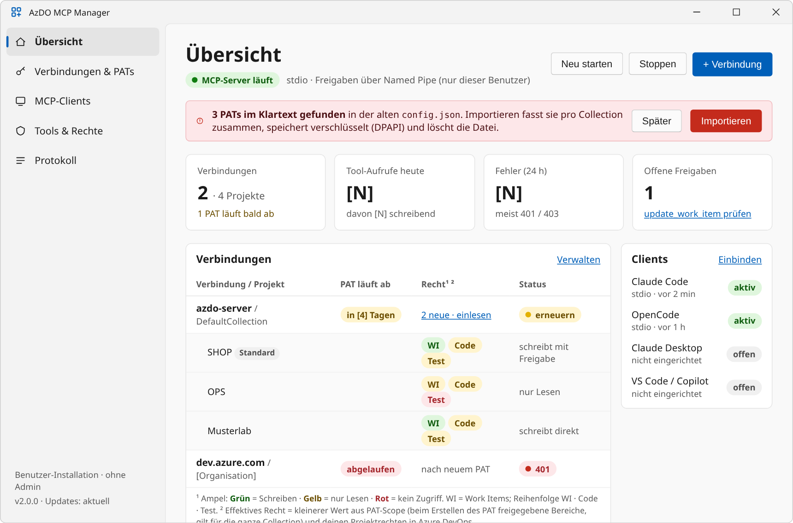
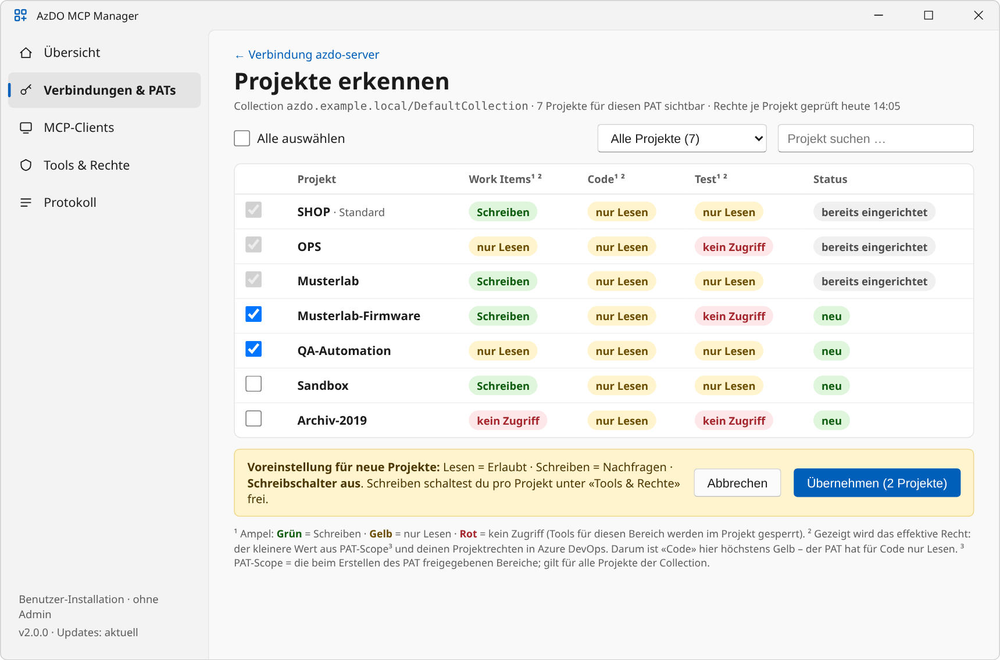
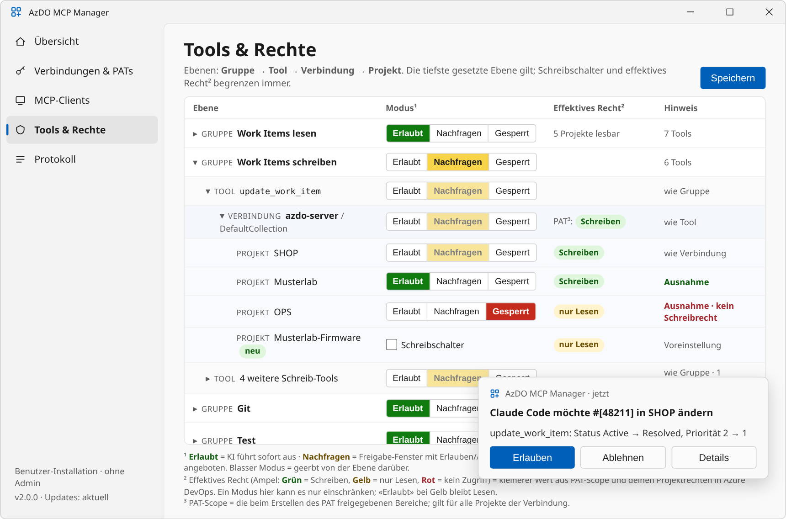
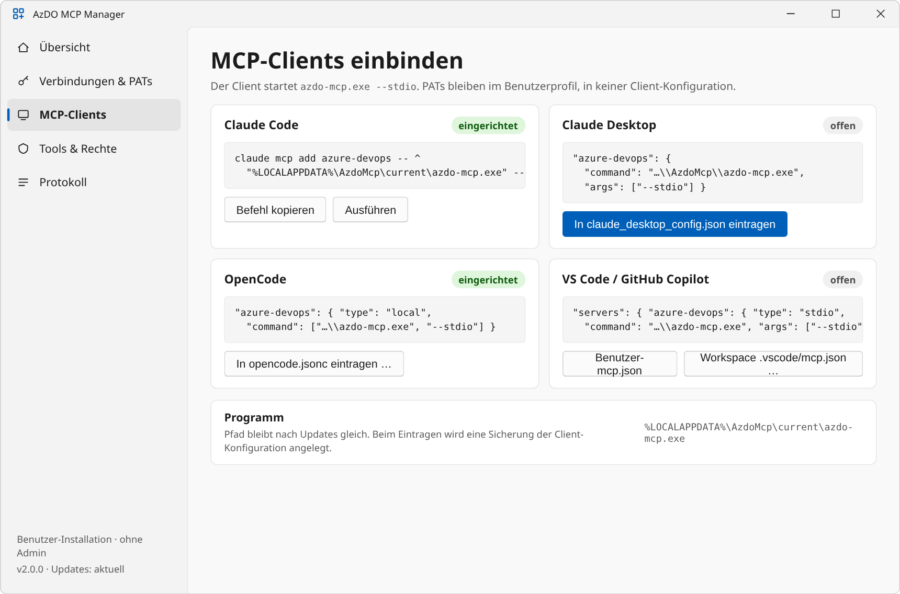
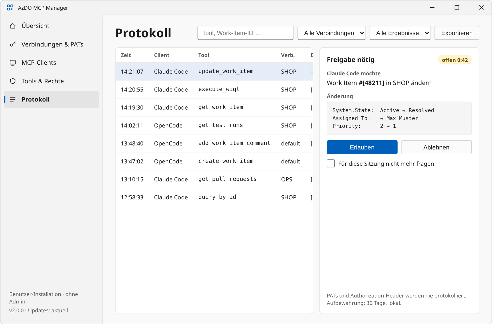

<div align="center">

<!-- App-Icon folgt: Sobald es ein Icon gibt, steht es hier (). -->

# AzDO MCP Manager

**Azure DevOps für Ihren KI-Assistenten – Sie bestimmen, was er darf.**



</div>

Sie möchten Work Items, Pull Requests, Pipelines und Testergebnisse nicht mehr zusammenklicken, sondern
einfach fragen – in Claude Code, Claude Desktop, OpenCode oder VS Code mit GitHub Copilot.
AzDO MCP Manager verbindet Ihren KI-Assistenten mit Azure DevOps Server (on-prem) und Azure DevOps Services.
Ihr Personal Access Token (PAT) bleibt verschlüsselt auf Ihrem Rechner, und Sie legen fest, was der
Assistent lesen, ändern oder nur nach Ihrer Freigabe tun darf. Für Windows, ohne Admin-Rechte.

> **Status: Vorabversion.** Die neueste Version finden Sie unter
> [Releases](https://github.com/trosinde/AzDO-mcp/releases/latest) – mit Setup, Portable-Variante und
> Handbuch als PDF.

## Warum AzDO MCP Manager

### In einer Minute verbunden

Sie geben Collection-URL und PAT ein, der Assistent findet alle Projekte, die Ihr PAT sieht, und zeigt je
Bereich, was Sie dort lesen und schreiben dürfen. Für jedes Projekt wählen Sie einen Kurznamen wie «SHOP»,
über den Sie es später im Prompt ansprechen.



### Sie bestimmen, was die KI darf

Schreiben ist pro Projekt zunächst ausgeschaltet. Jede Tool-Gruppe und jedes Tool steht auf «Erlaubt»,
«Nachfragen» oder «Gesperrt»; bei «Nachfragen» erscheint ein Freigabefenster mit «Erlauben» und «Ablehnen».



### Ein Klick für Ihren Assistenten

Die Seite «MCP-Clients» trägt den Server mit einem Klick in Claude Code, Claude Desktop, OpenCode oder
VS Code/Copilot ein – ohne JSON von Hand zu bearbeiten. Alternativ kopieren Sie einen fertigen Prompt, und der
Assistent richtet den Server selbst ein.



### Fragen statt Klickstrecken

Der Assistent wertet Pull Requests, Reviews, Branches, Builds und Testergebnisse für Sie aus und folgt
Verknüpfungen von der Story bis zum Test. Jeder Aufruf steht im Protokoll – nur Metadaten, nie Feldinhalte
oder Ihr PAT.



## Vorher und nachher

**Vorher:** In Azure DevOps Branches öffnen, nach Datum sortieren, für jeden Branch nach offenen Pull Requests
suchen und eine Liste abtippen.

**Nachher:** Eine Frage an den Assistenten:

```text
Welche Branches in SHOP haben seit 30 Tagen keinen Commit und keinen Pull Request?
```

## Loslegen

1. **Herunterladen und installieren** – Laden Sie `AzdoMcp-win-Setup.exe` aus dem
   [neuesten Release](https://github.com/trosinde/AzDO-mcp/releases/latest) und starten Sie die Datei mit einem
   Doppelklick. Es erscheint keine Admin-Abfrage; der Manager startet danach im Infobereich der Taskleiste.
2. **Verbindung anlegen** – Unter «Verbindungen & PATs» wählen Sie «+ Neue Verbindung», geben die
   Collection-URL (z. B. `https://azdo.example.local/DefaultCollection`) und Ihren PAT ein und richten die
   gefundenen Projekte ein.
3. **Assistenten einbinden** – Auf der Seite «MCP-Clients» tragen Sie den Server mit einem Klick bei Ihrem
   Assistenten ein und starten diesen neu.
4. **Testen** – Fragen Sie Ihren Assistenten: «Welche Azure-DevOps-Projekte kennst du?»

Ohne Installation geht es auch: Entpacken Sie `AzdoMcp-<Version>-portable.zip` in einen eigenen Ordner und
starten Sie `AzdoMcp.Manager.exe` (ohne automatische Updates).

Windows meldet «Der Computer wurde durch Windows geschützt», oder eine Firmenrichtlinie blockiert das Programm?
Das Handbuch beschreibt im Kapitel [Installation](docs/manual/03-installation.md), was zu tun ist.

## Mehr erfahren

- **Handbuch** – als PDF `AzdoMcp-Handbuch-<Version>.pdf` im
  [neuesten Release](https://github.com/trosinde/AzDO-mcp/releases/latest) und im Programmordner;
  Quelle in [docs/manual](docs/manual/index.md)
- **Tools** – alle Tools je Gruppe mit Beispielfragen: [Handbuch, Kapitel Tools](docs/manual/07-tools.md)
- **Sicherheit und Daten** – [Berechtigungen und Freigaben](docs/manual/06-berechtigungen-und-freigaben.md) ·
  [Protokoll und Daten](docs/manual/08-protokoll-und-daten.md)
- **Alle Dokumente** – [docs/README.md](docs/README.md)
- **Entwicklung** – Build, Tests und Release: [docs/entwicklung.md](docs/entwicklung.md)

## Roadmap

Erledigt:

- **MCP-Server** – Server für Azure DevOps Server und Services, PATs verschlüsselt (DPAPI), Protokoll
- **Tool-Rechte** – «Erlaubt», «Nachfragen», «Gesperrt» je Gruppe, Tool, Verbindung und Projekt, mit Freigabefenster
- **Tray-Manager** – Verwaltung von Verbindungen, PATs, Rechten, Freigaben und Clients ohne JSON
- **Windows-Pakete** – Setup pro Benutzer ohne Admin-Rechte und Portable-ZIP
- **Projekt-Erkennung** – eine Verbindung pro Collection, Projekte und effektive Rechte automatisch erkannt
- **Kurznamen** – Projekte im Prompt mit Kurznamen wie «SHOP» ansprechen
- **Einrichtungs-Prompts** – fertiger Prompt je Client, mit dem der Assistent den Server selbst einrichtet
- **Rechte-Anzeige** – Lesen und Schreiben je Bereich mit ja, nein, n/a und ?
- **Code- und Testauswertung** – Pull Requests, Branches, Pipelines, Testergebnisse, Verknüpfungen und Kennzahlen

In Arbeit:

- **Release und Handbuch** – signierte Releases mit Prüfsummen, Handbuch als PDF, diese README

Jede Änderung wird zuerst in [`openspec/changes/`](openspec/changes) beschrieben und dann umgesetzt – siehe
[Entwicklung](docs/entwicklung.md#arbeitsweise-spec-driven-mit-openspec).

## Projekt

Datenschutz: Alles bleibt auf Ihrem Rechner – PAT verschlüsselt, keine Telemetrie, der Manager spricht nur mit
Ihrem Azure DevOps (und mit Ihrer Update-Quelle, falls eingerichtet).
· [Beitragen](CONTRIBUTING.md) · [Sicherheitslücke melden](SECURITY.md) · Lizenz: [MIT](LICENSE)
