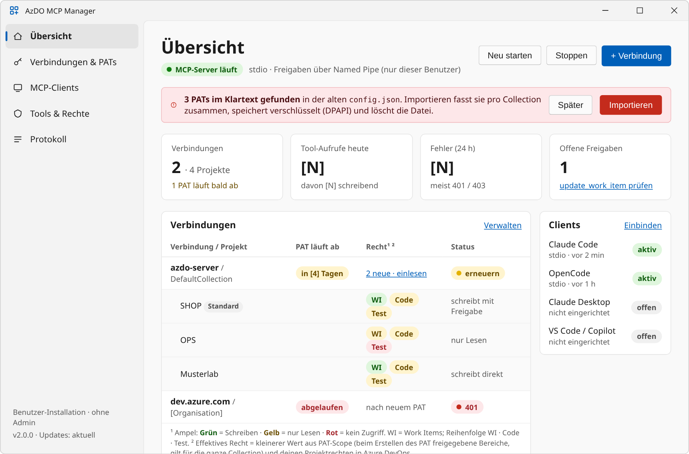

# Überblick

## Zweck

AzDO MCP Manager verbindet KI-Assistenten wie Claude Code, Claude Desktop, OpenCode oder VS Code mit GitHub Copilot mit Azure DevOps. Der Assistent kann damit Work Items, Pull Requests, Branches, Builds, Releases, Testergebnisse und Iterationen abfragen und, wenn Sie es erlauben, Work Items anlegen und ändern. Statt sich durch Azure DevOps zu klicken, stellen Sie eine Frage:

> Zeig die offenen Bugs in SHOP · gib mir aus SHOP das Work Item 4711

Dabei gilt:

- **Sie bestimmen, was die KI darf.** Für jede Tool-Gruppe, jedes Tool, jede Verbindung und jedes Projekt stellen Sie ein, ob der Assistent ein Tool sofort ausführt («Erlaubt»), vorher Ihre Freigabe braucht («Nachfragen») oder es gar nicht sieht («Gesperrt»). Schreiben ist für neue Projekte ausgeschaltet, bis Sie es bewusst freischalten.
- **Mehr als Ihre Rechte geht nie.** Der Assistent darf in einem Projekt höchstens, was Ihr Personal Access Token (PAT) und Ihre Projektrechte in Azure DevOps zulassen. Die Einstellungen im Manager können das nur weiter einschränken.
- **Ihr PAT bleibt bei Ihnen.** Der PAT wird mit Windows DPAPI verschlüsselt und kann nur von Ihrem Windows-Benutzer gelesen werden. Er steht in keiner Konfiguration eines KI-Clients, in keinem Protokoll und in keinem Tool-Ergebnis.
- **Keine Admin-Rechte.** Installation und Betrieb laufen ohne Admin-Rechte und ohne UAC-Abfrage, nur im Profil des angemeldeten Benutzers.
- **Alles bleibt lokal.** Die Programme sprechen nur mit Ihrem Azure DevOps. Server und Manager verständigen sich über einen lokalen Kanal, den nur Ihr Windows-Benutzer öffnen kann; es wird kein Netzwerk-Port geöffnet.

Unterstützt werden Azure DevOps Services (Cloud) und Azure DevOps Server (on-prem), siehe [Voraussetzungen](02-voraussetzungen.md).

Was AzDO MCP Manager nicht leistet:

- Er führt keine Git-Operationen aus (kein Klonen, kein Commit, kein Push) und ändert keine Pipelines, Tests oder Iterationen. Geschrieben werden nur Work Items, Kommentare, Verknüpfungen und Anhänge von Work Items.
- Er bewertet keine Inhalte. Auswertungen, etwa zur Dauer von Reviews, liefern Zahlen; die Bewertung von Kommentaren macht der KI-Assistent selbst.
- Er läuft nur unter Windows.

## Funktionsweise in einem Bild

```text
 KI-Assistent                azdo-mcp.exe                     Azure DevOps
 (Claude Code, ...)  stdio   (MCP-Server)          HTTPS + PAT   (Services oder
      |  -------------------->  prüft Kurzname,   ------------->   Server on-prem)
      |  <--------------------  Recht und Modus   <-------------
                                     |
                                     | lokaler Kanal (nur dieser Windows-Benutzer)
                                     v
                            AzdoMcp.Manager.exe (Tray)
                            Verbindungen, Rechte, Freigaben, Protokoll
```

1. Der KI-Client startet `azdo-mcp.exe --stdio` selbst, sobald er Tools braucht. Den Eintrag dafür legt die Seite «MCP-Clients» des Managers an (siehe [MCP-Clients](05-mcp-clients.md)).
2. Beim Verbinden nennt der Server dem Assistenten alle eingerichteten Projekte mit ihren Kurznamen, zum Beispiel `SHOP`, und das Standardprojekt. Nennen Sie im Prompt einen Kurznamen, weiss der Assistent, dass dieses Azure-DevOps-Projekt gemeint ist.
3. Ruft der Assistent ein Tool auf, prüft der Server, ob das Projekt eingerichtet ist, ob Ihr effektives Recht reicht, ob der Schreibschalter des Projekts eingeschaltet ist und welcher Modus gilt (siehe [Berechtigungen und Freigaben](06-berechtigungen-und-freigaben.md)).
4. Bei «Nachfragen» fragt der Server den Manager. Der Manager zeigt neben der Uhr ein Freigabefenster mit «Erlauben» und «Ablehnen». Ohne Antwort wird der Aufruf nach 2 Minuten abgelehnt.
5. Erst danach sendet der Server die Anfrage mit dem PAT der Verbindung an Azure DevOps und gibt das Ergebnis an den Assistenten zurück.
6. Jeder Aufruf steht im Protokoll, nur mit Metadaten (Zeit, Client, Tool, Verbindung, Dauer, Ergebnis), ohne Feldwerte oder Kommentartexte.

## Bestandteile

| Bestandteil | Datei | Aufgabe |
|---|---|---|
| MCP-Server | `azdo-mcp.exe` | Wird vom KI-Client gestartet (`azdo-mcp.exe --stdio`) und stellt die Azure-DevOps-Tools bereit. Jeder Client startet seine eigene Instanz. Zusätzlich gibt es den Befehl `azdo-mcp.exe discover` für die Projekterkennung ohne Oberfläche (siehe [Referenz](11-referenz.md)). |
| Manager | `AzdoMcp.Manager.exe` | Tray-App «AzDO MCP Manager»: Verbindungen und PATs, Projekte, Tools und Rechte, Freigaben, MCP-Clients, Protokoll. Startet mit der Windows-Anmeldung und läuft im Infobereich der Taskleiste. |
| Handbuch | `AzdoMcp-Handbuch.pdf` | Dieses Handbuch. Liegt im Programmordner, in der Portable-ZIP und als `AzdoMcp-Handbuch-<Version>.pdf` bei jedem Release. |
| Benutzerdaten | `%LOCALAPPDATA%\AzdoMcpData\` | Verbindungen, verschlüsselte PATs, Rechte und Protokoll. Getrennt vom Programmordner; bleibt bei Updates und Deinstallation erhalten (siehe [Protokoll und Daten](08-protokoll-und-daten.md)). |

Beide Programme bringen ihre .NET-Laufzeit mit. Nach der Installation liegen sie unter `%LOCALAPPDATA%\AzdoMcp\current\`; dieser Pfad bleibt auch nach Updates gleich.

Der Manager muss nicht laufen, damit der Assistent Tools mit dem Modus «Erlaubt» nutzen kann. Für Freigaben («Nachfragen») muss er laufen.

## Das Hauptfenster



Das Hauptfenster «AzDO MCP Manager» öffnen Sie mit einem Doppelklick auf das Symbol im Infobereich oder über «Verwaltung öffnen» im Tray-Menü. Links stehen die Seiten:

| Seite | Inhalt |
|---|---|
| «Übersicht» | Status des Servers («MCP-Server läuft» oder «MCP-Server pausiert») mit «Neu starten» und «Stoppen», die Kennzahlen «Verbindungen», «Tool-Aufrufe heute», «Fehler (24 h)» und «Offene Freigaben», die Tabelle «Verbindung / Projekt» mit Rechten und Status je Projekt und die Liste der Clients |
| «Verbindungen & PATs» | Verbindungen anlegen und bearbeiten, PAT ersetzen, Projekte erkennen, Kurznamen und Standardprojekt (siehe [Verbindungen und Projekte](04-verbindungen-und-projekte.md)) |
| «MCP-Clients» | Server in den KI-Clients eintragen (siehe [MCP-Clients](05-mcp-clients.md)) |
| «Tools & Rechte» | Modus je Gruppe, Tool, Verbindung und Projekt, Schreibschalter (siehe [Berechtigungen und Freigaben](06-berechtigungen-und-freigaben.md)) |
| «Protokoll» | Alle Tool-Aufrufe, offene Freigaben, Export (siehe [Protokoll und Daten](08-protokoll-und-daten.md)) |

Unten links zeigt der Fussbereich die Installationsart («Benutzer-Installation · ohne Admin» oder «Portable · ohne Admin») und die Version mit dem Update-Status (siehe [Update und Deinstallation](10-update-und-deinstallation.md)).

Schliessen Sie das Fenster, läuft der Manager im Infobereich weiter. Beendet wird er nur über «Beenden» im Tray-Menü.

## Begriffe

| Begriff | Bedeutung |
|---|---|
| **MCP** | Model Context Protocol: Standard, über den KI-Clients lokale Programme als Tools nutzen |
| **MCP-Client** | Der KI-Assistent, der den Server startet und seine Tools aufruft, z.B. Claude Code |
| **Tool** | Eine Funktion des Servers, z.B. `get_work_item` oder `update_work_item`. Alle Tools stehen in [Tools](07-tools.md). |
| **Tool-Gruppe** | Tools eines Bereichs, z.B. «Work Items lesen» oder «Git». Modi lassen sich je Gruppe setzen. |
| **Verbindung** | Eine Collection mit genau einem PAT, z.B. `https://azdo.example.local/DefaultCollection`. Darunter liegen die eingerichteten Projekte. |
| **Projekt** | Ein Azure-DevOps-Projekt, das in einer Verbindung eingerichtet ist. Nur eingerichtete Projekte sind für den Assistenten erreichbar. |
| **Kurzname** | Kurze Bezeichnung eines Projekts wie `SHOP`, über die Sie es im Prompt ansprechen |
| **Standardprojekt** | Projekt, das gilt, wenn der Assistent kein Projekt angibt |
| **PAT** | Personal Access Token: Zugangsschlüssel, den Sie in Azure DevOps erstellen |
| **PAT-Scope** | Die Bereiche, die beim Erstellen des PAT freigegeben wurden; gilt für die ganze Collection |
| **Effektives Recht** | Was der Server in einem Projekt höchstens darf: PAT-Scope kombiniert mit Ihren Projektrechten in Azure DevOps, je Bereich Lesen und Schreiben |
| **Schreibschalter** | Schalter je Projekt. Aus = alle Schreib-Tools für dieses Projekt gesperrt. |
| **Modus** | «Erlaubt», «Nachfragen» oder «Gesperrt» |
| **Freigabe** | Ihre Zustimmung zu einem einzelnen Tool-Aufruf mit Modus «Nachfragen» |
