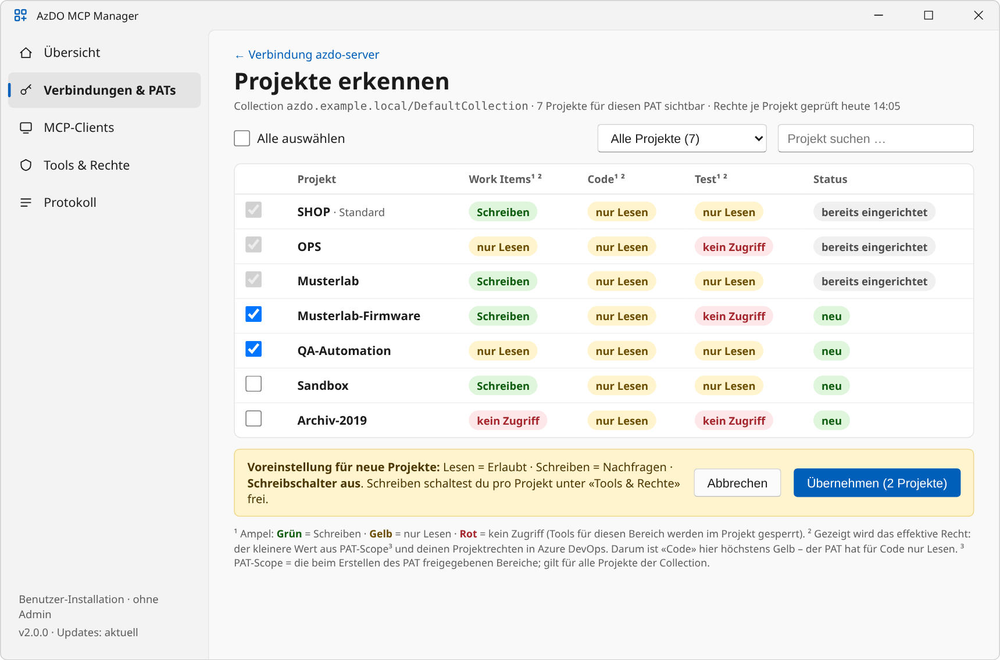
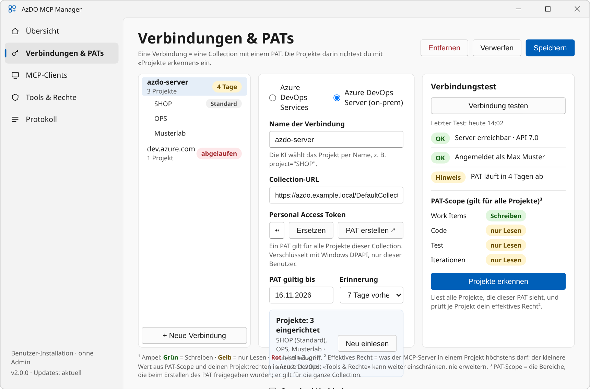
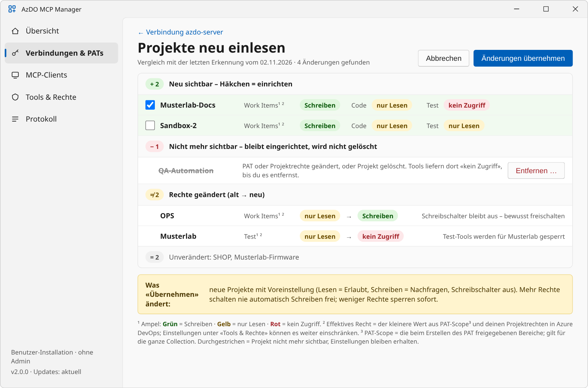

# Verbindungen und Projekte

Eine **Verbindung** ist eine Collection mit genau einem PAT, z.B. `https://azdo.example.local/DefaultCollection`. Darunter liegen die eingerichteten **Projekte**, z.B. `SHOP`, `OPS` und `Musterlab`. Ein PAT gilt für alle Projekte einer Collection; der Manager speichert ihn je Verbindung einmal, verschlüsselt.

Nur eingerichtete Projekte sind für den Assistenten erreichbar. Projekte, die Ihr PAT zwar sieht, die Sie aber nicht eingerichtet haben, kennt der Server nicht.

Verbindungen und Projekte richten Sie im Einrichtungs-Assistenten ein. Er führt in einem Durchgang von der Collection-URL und dem PAT bis zu fertig eingerichteten Projekten und geht dabei jedes ausgewählte Projekt einzeln durch.

## Rechte: Lesen und Schreiben je Bereich

An vielen Stellen zeigt der Manager Rechte je Bereich (Work Items, Code, Pipelines, Test, Iterationen) mit zwei Werten, **Lesen** und **Schreiben**. Jeder Wert ist einer von vier:

| Wert | Farbe | Bedeutung | Wirkung |
|---|---|---|---|
| «ja» | grün | geprüft, erlaubt | – |
| «nein» | rot | geprüft, verweigert | sperrt die Tools dieses Bereichs bzw. die Schreib-Tools |
| «n/a» | grau | ohne echtes Schreiben nicht prüfbar | sperrt nicht; Azure DevOps entscheidet beim Aufruf |
| «?» | grau | noch nicht geprüft | sperrt nicht; mit «Neu einlesen» prüfen |

Drei Arten von Rechten kommen vor:

- **PAT-Scope**: die Bereiche, die beim Erstellen des PAT freigegeben wurden; gilt für die ganze Collection. Ermittelt beim Verbindungstest.
- **Projektrecht**: Ihre eigenen Rechte im einzelnen Projekt in Azure DevOps, z.B. ob Sie dort Work Items bearbeiten dürfen. Ermittelt bei der Projekterkennung.
- **Effektives Recht**: was der MCP-Server in einem Projekt höchstens darf, kombiniert aus PAT-Scope und Projektrecht. Ist einer der beiden Werte «nein», gilt «nein»; sonst «?» vor «n/a» vor «ja».

Nur ein geprüftes «nein» schränkt ein. Die Einstellungen unter «Tools & Rechte» können das effektive Recht weiter einschränken, nie erweitern (siehe [Berechtigungen und Freigaben](06-berechtigungen-und-freigaben.md)).

> **Hinweis:** Die Projekterkennung schreibt nichts in Azure DevOps. Die einzige Anfrage, die nicht nur liest, ist eine Prüfung mit `validateOnly`, die feststellt, ob der PAT Work Items anlegen dürfte. Sie legt nichts an.

## Neue Verbindung einrichten

Klicken Sie auf «Verbindungen & PATs» und dort auf «+ Neue Verbindung» oder in der «Übersicht» auf «+ Verbindung». Der Assistent «Neue Verbindung einrichten» zeigt links die Schritte «Verbindung», «Projekte», je ausgewähltes Projekt einen Schritt und «Zusammenfassung». «Zurück» behält alle Eingaben, «Abbrechen» verwirft sie; gespeichert wird erst mit «Übernehmen».

### Schritt 1: Verbindung

Der Schritt sieht aus wie die Seite «Verbindungen & PATs» (Bild im Abschnitt „Verbindung bearbeiten“ weiter unten).

1. Server-Typ wählen: «Azure DevOps Services» oder «Azure DevOps Server (on-prem)».
2. «Collection-URL» eintragen, z.B. `https://azdo.example.local/DefaultCollection`. Sie muss mit `https://` beginnen.
3. Im Feld «Personal Access Token» den PAT einfügen. Haben Sie noch keinen, öffnet «PAT erstellen ↗» die Token-Seite Ihrer Collection im Browser (welche Scopes, steht in [Voraussetzungen](02-voraussetzungen.md)).
4. «PAT gültig bis» eintragen und bei «Erinnerung» wählen, wie früh Sie erinnert werden wollen («3 Tage vorher», «7 Tage vorher», «14 Tage vorher» oder «30 Tage vorher»). Die Erinnerung erscheint als Tray-Hinweis.
5. «Verbindung testen» klicken. Der Test zeigt:
   - «Server erreichbar · API …» oder «Server nicht erreichbar»
   - «Angemeldet als …» mit Ihrem Namen in Azure DevOps, z.B. «Angemeldet als Max Muster», oder «Anmeldung fehlgeschlagen»
   - einen Hinweis, wenn der PAT bald abläuft oder mit ihm kein Projekt sichtbar ist
   - unter «PAT-Scope (gilt für alle Projekte)» je Bereich die Werte für Lesen und Schreiben
6. «Name der Verbindung» prüfen. Er wird nach dem Test aus dem Servernamen vorgeschlagen und dient nur zur Anzeige in der Liste; der Assistent spricht Projekte über ihre Kurznamen an.
7. «Weiter». Der Knopf ist erst nach einem erfolgreichen Test aktiv.

### Schritt 2: Projekte auswählen

Der Manager liest alle Projekte, die Ihr PAT sieht, und prüft je Projekt Ihr effektives Recht. Während der Abfrage steht «Bitte warten – Azure DevOps wird abgefragt …».

Die Liste zeigt je Projekt ein Häkchen, den Namen, die Werte Lesen und Schreiben je Bereich und den Status «neu» oder «bereits eingerichtet». Mit dem Filter wählen Sie «Alle Projekte», «Nur neue» oder «Bereits eingerichtet»; «Alle auswählen» hakt alle neuen Projekte an.

- Vorausgewählt sind neue Projekte, in denen mindestens ein Bereich lesbar ist.
- Bereits eingerichtete Projekte werden angezeigt, lassen sich aber nicht anwählen. Ihre Einstellungen bleiben unverändert; nur die gespeicherten Rechte werden aktualisiert.
- Wählen Sie nur die Projekte, mit denen der Assistent arbeiten soll. Weitere können Sie später jederzeit mit «Projekte erkennen» oder «Neu einlesen» ergänzen.

«Weiter» führt zum ersten ausgewählten Projekt. Ist kein Projekt ausgewählt, heisst der Knopf «Weiter zur Zusammenfassung».

### Schritt 3: Projekt k von n

Für jedes ausgewählte Projekt erscheint ein eigener Schritt, z.B. «Projekt 1 von 3 · Musterlab». Rechts steht das effektive Recht des Projekts. Sie legen fest:

| Feld | Bedeutung | Voreinstellung |
|---|---|---|
| «Kurzname» | Name, über den Sie das Projekt im Prompt ansprechen (Regeln siehe unten). Darunter zeigt eine Vorschau, wie Sie es ansprechen, z.B. «So sprichst du es an: „offene Bugs in SHOP“». | Vorschlag aus dem Projektnamen |
| «Standardprojekt» | Gilt, wenn der Assistent kein Projekt angibt. Es gibt genau ein Standardprojekt über alle Verbindungen. | Das erste eingerichtete Projekt |
| «Schreibschalter» | «Schreib-Tools für dieses Projekt zulassen». Aus = der Assistent kann in diesem Projekt nichts schreiben, unabhängig von allen Modi. | aus |
| «Modus je Tool-Gruppe» | «Erlaubt», «Nachfragen» oder «Gesperrt» für jede Tool-Gruppe | Lesen = Erlaubt · Schreiben = Nachfragen |

Ist der Schreibschalter nicht verfügbar, nennt der Assistent den Grund, z.B. «PAT ohne Schreibrecht» oder «kein Projektrecht zum Bearbeiten». Ist Schreiben nicht prüfbar («n/a» oder «?»), lässt sich der Schalter einschalten, mit dem Hinweis «Schreibrecht nicht prüfbar – Azure DevOps entscheidet beim Schreiben».

Tool-Gruppen, deren Bereich im Projekt nicht lesbar ist (Lesen «nein»), zeigen «kein Zugriff» und bleiben auf «Gesperrt».

Feinere Einstellungen pro Tool machen Sie später unter «Tools & Rechte».

Mit «Übrige mit Voreinstellung» übernehmen alle restlichen Projekte die Voreinstellung, und der Assistent springt zur Zusammenfassung.

### Schritt 4: Zusammenfassung

Die Zusammenfassung listet jedes ausgewählte Projekt mit Kurzname, effektivem Recht, Schreibschalter und den geänderten Modi. «Übernehmen (N Projekte)» speichert in einem Schritt:

- die Verbindung mit dem PAT, einmal und verschlüsselt,
- die Projekte,
- nur die Modi, die Sie gegenüber der Voreinstellung geändert haben. Nicht geänderte Modi folgen weiterhin den globalen Einstellungen unter «Tools & Rechte».

Laufende Server lesen die Änderung danach selbst neu ein; der KI-Client muss nicht neu gestartet werden.

## Kurznamen

Jedes Projekt hat einen Kurznamen, über den Sie es im Prompt ansprechen, ohne zu sagen, dass es um Azure DevOps geht:

> Zeig die offenen Bugs in SHOP · gib mir aus SHOP das Work Item 4711

Der Server nennt dem Assistenten beim Verbinden alle Kurznamen mit ihren Projektnamen und das Standardprojekt. Nennen Sie einen Kurznamen, ruft der Assistent die Tools direkt für dieses Projekt auf, ohne nachzufragen.

Regeln:

- 2 bis 10 Zeichen aus Buchstaben, Ziffern und `-`, beginnt mit einem Buchstaben.
- Eindeutig über alle Verbindungen. Gross- und Kleinschreibung spielt keine Rolle; gespeichert wird in Grossbuchstaben (`ops` wird zu `OPS`).
- Nicht erlaubt sind `PR`, `BUG`, `ID`, `TEST`, `TASK` und `ALL`, weil sie in Prompts eine andere Bedeutung haben.

Der Vorschlag entsteht aus dem Projektnamen: bei mehreren Wörtern die Anfangsbuchstaben («Demo Project One» wird `DPO`), bei einem Wort bis 8 Zeichen das Wort selbst, sonst die ersten fünf Buchstaben. Ist der Vorschlag schon vergeben, hängt der Manager eine Ziffer an (`OPS2`).

Verstösst ein Kurzname gegen die Regeln, blockiert der Assistent «Weiter» und zeigt die Regel rot, z.B. «Kurzname: 2–10 Zeichen, Buchstaben, Ziffern und -, beginnt mit Buchstabe» oder «Kurzname „SHOP“ wird bereits verwendet».

**Kurznamen ändern:** Unter «Verbindungen & PATs» steht bei der gewählten Verbindung unter «Kurznamen» je Projekt ein Feld. Nach «Speichern» warnt der Manager: «Prompts mit dem alten Kurznamen funktionieren danach nicht mehr.» Die Einstellungen des Projekts unter «Tools & Rechte» bleiben erhalten. Laufende Server melden dem Client die geänderte Tool-Liste mit dem neuen Kurznamen.

Projekte aus älteren Versionen können einen Kurznamen haben, der die Regeln nicht erfüllt. Er funktioniert weiter, bis Sie ihn ändern; das Feld zeigt dann «entspricht nicht den Kurznamen-Regeln – Vorschlag: …».

> **Hinweis:** Work-Item-IDs gelten für die ganze Collection. Ein Tool liest oder ändert nur Work Items des angegebenen Projekts. Fragen Sie in `SHOP` nach einem Work Item, das in `OPS` liegt, lehnt der Server ab, z.B. mit «Work Item 5000 gehört nicht zu SHOP – es liegt in OPS».

## Verbindung bearbeiten

Die Seite «Verbindungen & PATs» zeigt links alle Verbindungen, darunter eingerückt ihre Projekte. Für die gewählte Verbindung bearbeiten Sie rechts:

| Feld / Knopf | Wirkung |
|---|---|
| Server-Typ, «Name der Verbindung», «Collection-URL» | wie beim Einrichten |
| «Personal Access Token» | zeigt nur Punkte. Der gespeicherte PAT lässt sich nicht anzeigen. |
| «Ersetzen» | neuen PAT eingeben, z.B. nach Ablauf. Danach auch «PAT gültig bis» anpassen und «Verbindung testen». |
| «PAT gültig bis», «Erinnerung» | Ablaufdatum und Vorlauf der Erinnerung |
| Kasten «Projekte: N eingerichtet» | eingerichtete Projekte und Datum der letzten Erkennung, mit «Neu einlesen» |
| «Kurznamen» | Kurzname je Projekt ändern |
| «Standardprojekt» | Auswahl über alle Projekte aller Verbindungen. «Gilt, wenn die KI kein Projekt angibt.» |
| «Verbindungstest» | «Verbindung testen» zeigt Anmeldung und PAT-Scope; «Projekte erkennen» öffnet den Assistenten im Schritt «Projekte» |
| «Speichern», «Verwerfen» | Änderungen speichern oder verwerfen. Verlassen Sie die Seite mit ungespeicherten Änderungen, fragt der Manager nach. |
| «Entfernen» | Entfernt die Verbindung mit allen Projekten und dem PAT, nach Rückfrage. Die Einstellungen der Projekte gehen verloren. |

**Ablauf des PAT:** Der Status der Verbindung ist grün, solange mehr Zeit als der Vorlauf bleibt, gelb mit «in N Tagen» und «PAT erneuern» innerhalb des Vorlaufs und rot mit «abgelaufen» nach dem Ablaufdatum oder nach einer Antwort 401 von Azure DevOps. Einmal pro Tag erscheint im Infobereich eine Erinnerung, z.B. «PAT für <Verbindung> läuft in 4 Tagen ab». Erstellen Sie dann in Azure DevOps einen neuen PAT und tragen Sie ihn mit «Ersetzen» ein.

## Projekte erkennen

Mit «Projekte erkennen» im Bereich «Verbindungstest» richten Sie weitere Projekte einer bestehenden Verbindung ein. Der Assistent «Projekte erkennen · <Verbindung>» beginnt direkt beim Schritt «Projekte»; der Ablauf ist derselbe wie beim Einrichten. Bestehende Projekte behalten Kurzname, Standard, Schreibschalter und Modi; nur ihre gespeicherten Rechte werden aktualisiert.

## Neu einlesen

Rechte und Projekte ändern sich mit der Zeit: Sie bekommen Zugriff auf ein neues Projekt, ein Projekt wird gelöscht, oder Ihre Rechte ändern sich. «Neu einlesen» (in der «Übersicht» je Verbindung oder im Kasten «Projekte: N eingerichtet») vergleicht den aktuellen Stand mit der letzten Erkennung. Die Seite «Projekte neu einlesen · <Verbindung>» zeigt:

| Gruppe | Inhalt | Was passiert |
|---|---|---|
| «Neu sichtbar – Häkchen = einrichten» | Projekte, die der PAT jetzt zusätzlich sieht, mit Lesen und Schreiben je Bereich | Angehakte Projekte durchlaufen vor dem Speichern die Projekt-Schritte des Assistenten |
| «Nicht mehr sichtbar – bleibt eingerichtet, wird nicht gelöscht» | Eingerichtete Projekte, die der PAT nicht mehr sieht | Bleiben eingerichtet; ihre Tools liefern «kein Zugriff». Mit «Entfernen …» entfernen Sie ein Projekt samt Einstellungen nach Rückfrage. |
| «Rechte geändert (alt → neu)» | Jede geänderte Angabe, z.B. «Work Items Schreiben: ja → nein» | Gemeldet werden nur Wechsel von oder zu «nein»; andere Änderungen speichert der Manager still |
| «Unverändert» | alle übrigen Projekte | – |

«Änderungen übernehmen» speichert das Ergebnis. Dabei gilt:

- Nichts wird automatisch gelöscht.
- **Mehr Rechte schalten nie automatisch Schreiben frei.** Bekommt `OPS` neu das Recht, Work Items zu bearbeiten, bleibt der Schreibschalter aus, bis Sie ihn bewusst einschalten.
- **Weniger Rechte sperren sofort.** Fällt in `Musterlab` das Lesen von Test auf «nein», sind die Test-Tools dort nach dem Übernehmen gesperrt.
- Kurzname, Standard, Schreibschalter und Modi bestehender Projekte ändern sich nie.

Führen Sie «Neu einlesen» nach einem Update aus, wenn Projekte einen Bereich mit «?» zeigen, und immer dann, wenn sich Ihre Rechte in Azure DevOps geändert haben.

## Status je Projekt in der Übersicht

Die Tabelle «Verbindung / Projekt» in der «Übersicht» zeigt je Verbindung den Ablauf des PAT und je Projekt die effektiven Rechte und einen Status:

| Status | Bedeutung |
|---|---|
| «schreibt direkt» | Schreiben möglich, Schreib-Tools laufen ohne Freigabe |
| «schreibt mit Freigabe» | Schreiben möglich, jede Änderung braucht Ihre Freigabe |
| «nur Lesen · PAT» | Der PAT darf keine Work Items schreiben |
| «nur Lesen · Projektrecht» | Sie dürfen in diesem Projekt keine Work Items bearbeiten |
| «nur Lesen · Schreibschalter aus» | Der Schreibschalter des Projekts ist aus |
| «nur Lesen · Schreib-Tools gesperrt» | Alle Schreib-Tools sind für dieses Projekt auf «Gesperrt» |
| «kein Zugriff» | Kein Bereich des Projekts ist lesbar |
| «nicht mehr sichtbar» | Der PAT sieht das Projekt nicht mehr (siehe Neu einlesen) |

Ist Schreiben möglich, aber nicht geprüft («n/a» oder «?»), steht zusätzlich «· Schreibrecht nicht geprüft». Ein Tooltip zeigt, wie der Status zustande kommt.

Ohne Oberfläche erkennen Sie Projekte mit `azdo-mcp.exe discover <Verbindung>` (siehe [Referenz](11-referenz.md)).
