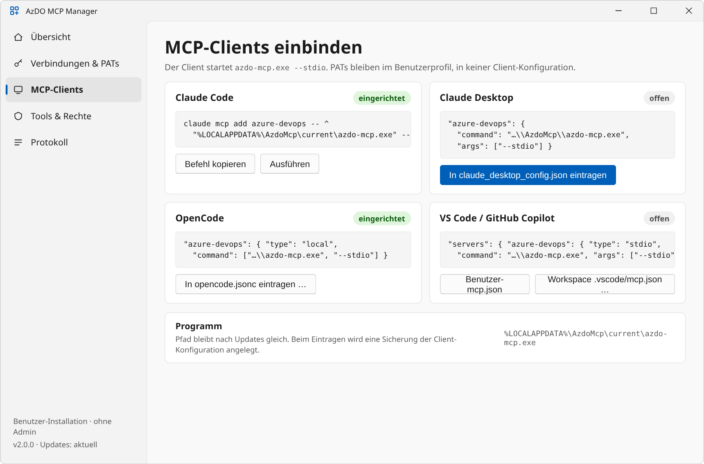

# MCP-Clients

Damit Ihr KI-Assistent die Azure-DevOps-Tools nutzen kann, muss er den Server kennen. Die Seite «MCP-Clients» im Manager trägt ihn mit einem Klick ein oder liefert einen Prompt, mit dem der Assistent sich selbst einrichtet.

Der Eintrag ist für alle Clients gleich aufgebaut:

| Angabe | Wert |
|---|---|
| Name des Servers | `azure-devops` |
| Programm | `%LOCALAPPDATA%\AzdoMcp\current\azdo-mcp.exe` (im Eintrag ausgeschrieben). Bei der Portable-Variante der Pfad im entpackten Ordner. |
| Argument | `--stdio` |

Der Eintrag enthält keinen PAT, keine Collection-URL und keine Projektnamen. PATs bleiben verschlüsselt im Benutzerprofil, in keiner Client-Konfiguration. Unten auf der Seite steht unter «Programm» der Pfad zum Server mit «Pfad kopieren» und dem Hinweis «Pfad bleibt nach Updates gleich. Beim Eintragen wird eine Sicherung der Client-Konfiguration angelegt.»

## Status je Client

Jede Karte zeigt oben rechts den Status:

| Status | Bedeutung |
|---|---|
| «eingerichtet» | Der Client hat einen Eintrag für `azdo-mcp.exe` |
| «offen» | Noch kein Eintrag |
| «prüfen» (gelb) | Nur bei OpenCode: Die Datei enthält unter `mcp` einen Block `servers`, den OpenCode nicht liest, auch wenn ein Eintrag `azure-devops` vorhanden ist. Die Karte zeigt dazu «„servers“ unter „mcp“ ist kein gültiger Eintrag – Prompt nutzen oder Datei korrigieren». |
| «Datei fehlerhaft» (rot) | Die Konfigurationsdatei des Clients ist kein gültiges JSON. Der Manager schreibt dann nichts hinein. |

Die «Übersicht» zeigt dieselben Clients unten mit «aktiv», «eingerichtet» oder «offen» und dem Link «Einbinden».

## Ein-Klick-Einrichtung

| Client | Knopf | Was passiert |
|---|---|---|
| Claude Code | «Befehl kopieren» | Kopiert den Befehl `claude mcp add --scope user azure-devops -- "<Pfad>\azdo-mcp.exe" --stdio` in die Zwischenablage. Führen Sie ihn in einem Terminal aus. |
| Claude Code | «Ausführen» | Führt denselben Befehl direkt aus, wenn die Claude-Code-CLI gefunden wird. Sonst erscheint «Claude-Code-CLI („claude“) nicht gefunden. Befehl kopieren und in einem Terminal ausführen.» |
| Claude Desktop | «In claude_desktop_config.json eintragen» | Trägt den Server unter `mcpServers` in `%APPDATA%\Claude\claude_desktop_config.json` ein |
| OpenCode | «In opencode.jsonc eintragen» (bzw. `opencode.json`) | Trägt den Server unter `mcp` in `%USERPROFILE%\.config\opencode\opencode.jsonc` ein; Kommentare in der Datei bleiben erhalten |
| VS Code / GitHub Copilot | «Benutzer-mcp.json» | Trägt den Server unter `servers` in `%APPDATA%\Code\User\mcp.json` ein und gilt damit für alle Workspaces |
| VS Code / GitHub Copilot | «Workspace .vscode/mcp.json …» | Fragt nach einem Workspace-Ordner und trägt den Server in dessen `.vscode\mcp.json` ein |

Beim Eintragen in eine Datei gilt:

- Der Manager ändert nur seinen eigenen Eintrag `azure-devops`. Andere Server und Einstellungen bleiben unverändert.
- Vorher legt er neben der Datei eine Sicherung an: `<Datei>.azdo-mcp-backup-<JJJJMMTThhmmss>`.
- Danach meldet er «Eingetragen» mit dem Pfad der Datei und der Sicherung. Kann er nicht schreiben, meldet er «Nicht eingetragen» und «Die Datei wurde nicht verändert.» mit dem Grund.

Starten Sie den Client danach neu, damit er den Server lädt.

## Prompt zum Einrichten

Jede Karte enthält den Abschnitt «Prompt zum Einrichten» mit einem fertigen Text. Statt des Ein-Klick-Eintrags kopieren Sie ihn mit «Prompt kopieren» und fügen ihn in den Assistenten ein; der Assistent richtet den Server dann selbst ein. Das hilft, wenn Sie den Eintrag nachvollziehen wollen, wenn eine Datei von Hand bearbeitet wurde oder wenn bei OpenCode ein ungültiger Block `servers` korrigiert werden muss.

| Client | Wohin einfügen | Was der Prompt verlangt |
|---|---|---|
| Claude Code | «In Claude Code einfügen» | Den Befehl `claude mcp add …` ausführen, einen vorhandenen Eintrag vorher entfernen, das Ergebnis mit `claude mcp list` prüfen |
| Claude Desktop | «für einen Assistenten mit Dateizugriff (z. B. Claude Code)» | `claude_desktop_config.json` bearbeiten, den Eintrag unter `mcpServers` anlegen oder ersetzen, danach Claude Desktop neu starten |
| OpenCode | «In OpenCode einfügen» | Den Eintrag direkt unter `mcp` anlegen oder ersetzen, Einträge aus einem Zwischenschlüssel `servers` eine Ebene nach oben verschieben, danach OpenCode neu starten |
| VS Code / GitHub Copilot | «Im Agent-Modus von GitHub Copilot einfügen» | Den Eintrag unter `servers` in der Benutzerdatei `mcp.json` anlegen oder ersetzen, danach in VS Code «MCP: List Servers» öffnen und `azure-devops` starten |

Alle Prompts verlangen vom Assistenten, die Datei vorher zu sichern, sonst nichts zu ändern (auch keine Tokens, Header oder anderen Server) und gültiges JSON zu schreiben. Sie enthalten keinen PAT, keine Collection-URL und keinen Projektnamen und lassen sich deshalb gefahrlos weitergeben.

Der Prompt für Claude Desktop verlangt das Bearbeiten einer Datei. Fügen Sie ihn deshalb in einen Assistenten mit Dateizugriff ein, z.B. Claude Code.

## Testfrage

Nach dem Neustart des Clients prüfen Sie die Einrichtung mit der Testfrage, die auf jeder Karte steht:

> Welche Azure-DevOps-Projekte kennst du?

Der Assistent sollte Ihre eingerichteten Projekte mit ihren Kurznamen nennen, z.B. `SHOP`, `OPS` und `Musterlab`, und das Standardprojekt. Ist ein Standardprojekt eingerichtet, schlägt die Karte zusätzlich eine zweite Frage vor, z.B.:

> Zeig die offenen Bugs in SHOP

Bleibt die Antwort aus oder kennt der Assistent keine Projekte:

- Ist der Client wirklich neu gestartet? Viele Clients laden ihre Server nur beim Start.
- Zeigt die Karte «eingerichtet»? Wenn nicht, erneut eintragen.
- Sind Projekte eingerichtet (siehe [Verbindungen und Projekte](04-verbindungen-und-projekte.md))? Ohne Projekte meldet der Server dem Assistenten, dass noch kein Projekt eingerichtet ist.
- Erscheint der Aufruf im «Protokoll»? Weitere Ursachen stehen in [Meldungen und Fehlerbehebung](09-meldungen-und-fehlerbehebung.md).

## Mehrere Clients gleichzeitig

Jeder Client startet seine eigene Instanz von `azdo-mcp.exe`. Alle Instanzen nutzen dieselben Verbindungen und Rechte. Der Manager zeigt aktive Clients in der «Übersicht» und im Tray-Menü («Server läuft · N Clients aktiv»).

Ändern Sie Verbindungen, Kurznamen oder Rechte im Manager, lesen laufende Server sie selbst neu ein; ein Neustart des Clients ist nicht nötig. «Neu starten» in der «Übersicht» oder «Server neu starten» im Tray-Menü veranlasst alle laufenden Server, Verbindungen und Rechte sofort neu einzulesen.
