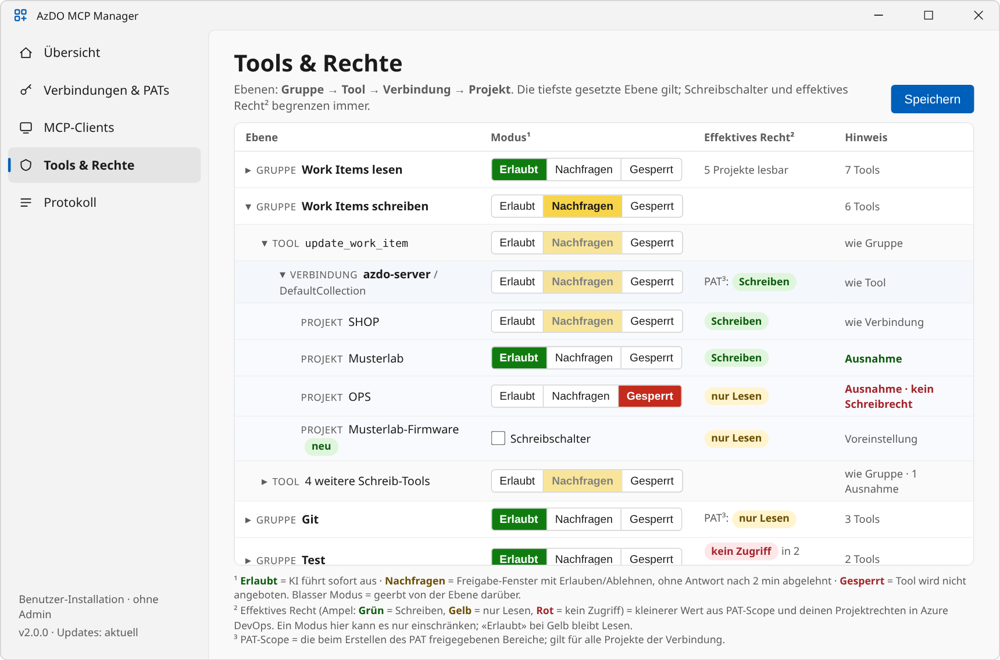
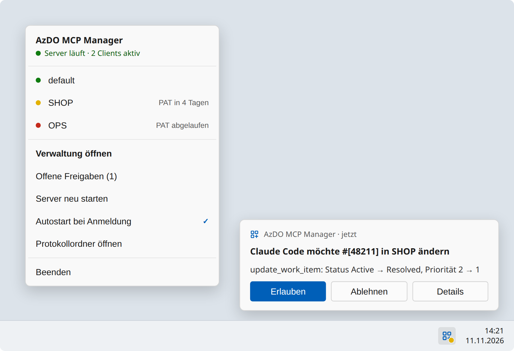
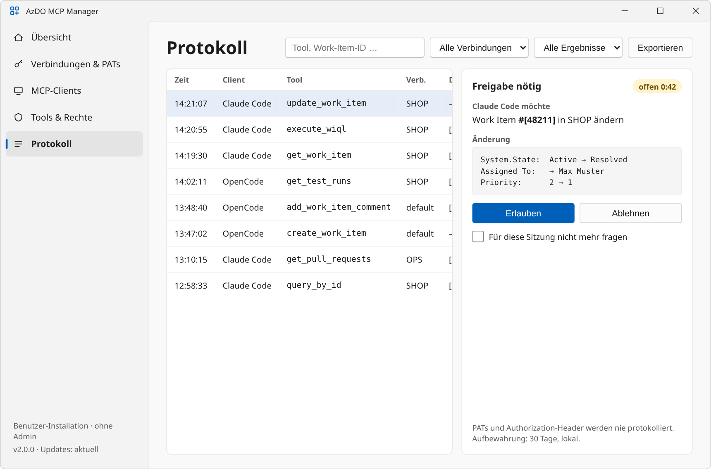

# Berechtigungen und Freigaben

Was der Assistent in einem Projekt tun darf, hängt von vier Dingen ab. Es gilt immer die strengste Einschränkung:

| Stufe | Wo eingestellt | Wirkung |
|---|---|---|
| **Effektives Recht** | in Azure DevOps (PAT-Scope und Ihre Projektrechte), ermittelt bei der Erkennung | Ein «nein» sperrt die betroffenen Tools. Mehr als Ihr effektives Recht geht nie. |
| **Sichtbarkeit** | ermittelt bei «Neu einlesen» | Ein Projekt, das der PAT nicht mehr sieht, liefert für jedes Tool «kein Zugriff». |
| **Schreibschalter** | je Projekt, unter «Tools & Rechte» oder im Einrichtungs-Assistenten | Aus = alle Schreib-Tools für dieses Projekt gesperrt |
| **Modus** | unter «Tools & Rechte» | «Erlaubt», «Nachfragen» oder «Gesperrt» je Gruppe, Tool, Verbindung und Projekt |

Ein Modus kann das effektive Recht nur einschränken, nie erweitern. Steht ein Tool auf «Erlaubt», hat das Projekt aber keinen Zugriff auf den Bereich, wird der Aufruf trotzdem abgelehnt.

## Lesen und Schreiben

Rechte zeigt der Manager je Bereich mit den Werten **Lesen** und **Schreiben** (Bedeutung der Werte «ja», «nein», «n/a», «?» in [Verbindungen und Projekte](04-verbindungen-und-projekte.md)). Welcher Wert für eine Tool-Gruppe zählt:

- Lese-Gruppen brauchen das Lesen ihres Bereichs. Ist es «nein», ist die Gruppe im Projekt gesperrt.
- «Work Items schreiben» braucht das Schreiben im Bereich Work Items. Ist es «nein», sind die Schreib-Tools im Projekt gesperrt, auch bei eingeschaltetem Schreibschalter.
- «n/a» und «?» sperren nicht. Bei «n/a» entscheidet Azure DevOps beim Aufruf selbst.

Schreiben kann der Assistent nur Work Items: anlegen, ändern, Kommentare, Verknüpfungen und Anhänge. Alle anderen Gruppen lesen nur.

## Die drei Modi

| Modus | Wirkung |
|---|---|
| **Erlaubt** | Der Assistent führt das Tool sofort aus, ohne Rückfrage. Funktioniert auch, wenn der Manager nicht läuft. |
| **Nachfragen** | Vor jedem Aufruf erscheint ein Freigabefenster mit «Erlauben» und «Ablehnen». Ohne Antwort wird der Aufruf nach 2 Minuten abgelehnt. Der Manager muss laufen. |
| **Gesperrt** | Das Tool wird nicht ausgeführt. Ist es für alle Projekte gesperrt, bietet der Server es dem Assistenten gar nicht erst an. Ist es nur für einige Projekte gesperrt, nennt seine Beschreibung diese Projekte. |

Die Seite «Tools & Rechte» fasst das so zusammen: «Erlaubt = KI führt sofort aus · Nachfragen = Freigabe-Fenster mit Erlauben/Ablehnen, ohne Antwort nach 2 min abgelehnt · Gesperrt = Tool wird nicht angeboten. Blasser Modus = geerbt von der Ebene darüber.»

## Tool-Gruppen

| Gruppe | Bereich | Tools (Beispiele) | Voreinstellung |
|---|---|---|---|
| **Work Items lesen** | Work Items (Lesen) | `get_work_item`, `execute_wiql`, `query_work_items`, `trace_links` und weitere, 8 Tools | Erlaubt |
| **Work Items schreiben** | Work Items (Schreiben) | `create_work_item`, `update_work_item`, `add_work_item_comment` und weitere, 6 Tools | Nachfragen |
| **Git** | Code (Lesen) | `get_repositories`, `get_pull_requests`, `analyze_pull_requests` und weitere, 6 Tools | Erlaubt |
| **Pipelines** | Pipelines (Lesen) | `get_pipelines`, `get_builds`, `get_releases` | Erlaubt |
| **Test** | Test (Lesen) | `get_test_plans`, `get_test_runs`, `get_test_results`, `analyze_test_results` | Erlaubt |
| **Planung** | Iterationen (Lesen) | `get_iterations`, `get_iteration_capacity` | Erlaubt |
| **System** | – | `list_projects`, `ping` | immer Erlaubt, nicht einstellbar |

Alle Tools mit ihren Parametern stehen in [Tools](07-tools.md).

Zusätzlich ist für neue Projekte der Schreibschalter aus. Ohne weitere Einstellung kann der Assistent also überall lesen, aber nirgends schreiben, bis Sie für ein Projekt den Schreibschalter einschalten; danach fragt er vor jeder Änderung nach.

## Tools & Rechte

Die Seite «Tools & Rechte» zeigt alle Einstellungen als aufklappbaren Baum: «Ebenen: Gruppe → Tool → Verbindung → Projekt. Die tiefste gesetzte Ebene gilt; Schreibschalter und effektives Recht² begrenzen immer.»

| Spalte | Inhalt |
|---|---|
| «Ebene» | Gruppe, darunter ihre Tools, darunter je Verbindung und Projekt eine Zeile. Auf Verbindungs- und Projektebene gibt es auch eine Zeile für alle Tools der Gruppe. |
| «Modus¹» | Schalter «Erlaubt» / «Nachfragen» / «Gesperrt». Ein blasser Modus ist von der Ebene darüber geerbt. |
| «Effektives Recht²» | Bei Projektzeilen der Wert, den die Gruppe braucht, z.B. «Work Items Schreiben», grün «ja», rot «nein» oder grau «n/a» bzw. «?» |
| «Hinweis» | Woher der Modus stammt: «wie Gruppe», «wie Tool», «wie Verbindung», «wie Projekt (alle Tools)» oder «Ausnahme» für einen eigenen Wert. Bei «nein» steht der Grund, z.B. «PAT ohne Schreibrecht» oder «kein Projektrecht zum Bearbeiten». |

So setzen Sie einen Modus:

1. Gruppe aufklappen und die Zeile wählen: die Gruppe selbst, ein Tool, eine Verbindung oder ein Projekt.
2. Im Schalter den Modus wählen. Die Zeile zeigt danach «Ausnahme».
3. «Speichern». Laufende Server übernehmen die Änderung ohne Neustart des Clients.

Mit «↺» («Ausnahme entfernen (wieder erben)») nehmen Sie einen eigenen Wert zurück; die Zeile erbt dann wieder von der Ebene darüber. Verlassen Sie die Seite mit ungespeicherten Änderungen, fragt der Manager «Geänderte Rechte speichern?».

**Reihenfolge:** Gesetzt werden kann ein Modus auf jeder Ebene. Es gilt die tiefste Ebene, die einen Modus hat:

1. Projekt und Tool
2. Projekt und Gruppe
3. Verbindung und Tool
4. Verbindung und Gruppe
5. Tool
6. Gruppe
7. Voreinstellung

Beispiele:

- «Work Items schreiben» steht auf «Nachfragen», `add_work_item_comment` auf «Erlaubt»: Kommentare schreibt der Assistent ohne Rückfrage, `update_work_item` fragt weiter nach.
- `update_work_item` steht auf «Nachfragen», im Projekt `Musterlab` auf «Erlaubt»: In `Musterlab` ändert der Assistent Work Items ohne Rückfrage, in `SHOP` fragt er nach.
- Auf der Zeile der Verbindung von `OPS` unter «Work Items schreiben» steht «Gesperrt»: Die Schreib-Tools sind für alle Projekte dieser Verbindung gesperrt.

**Schreibschalter:** Auf Projektebene steht zusätzlich der «Schreibschalter» («Aus = Schreib-Tools für dieses Projekt gesperrt»). Er gilt unabhängig von allen Modi. Mehr Rechte in Azure DevOps schalten ihn nie automatisch ein.

## Freigabe erteilen

Ruft der Assistent ein Tool mit dem Modus «Nachfragen» auf, wartet der Server auf Ihre Entscheidung, bevor er etwas an Azure DevOps sendet.

Neben dem Infobereich erscheint ein Freigabefenster:

- Kopf «AzDO MCP Manager · jetzt»
- Titel, wer was möchte, z.B. «Claude Code möchte #48211 in SHOP ändern». Beim Anlegen steht z.B. «… möchte ein Bug in SHOP anlegen», bei Tools ohne Work-Item-ID «… möchte <Tool> in SHOP ausführen».
- Tool und Zusammenfassung der Änderung, z.B. «update_work_item: Status Active → Resolved, Priorität 2 → 1»
- die verbleibende Zeit, z.B. «noch 1:45»
- die Knöpfe «Erlauben», «Ablehnen» und «Details». «Details» öffnet das «Protokoll» mit dieser Anfrage.

Das Fenster schliesst sich, sobald Sie entschieden haben oder die Zeit abgelaufen ist. Das Ergebnis:

| Entscheidung | Antwort an den Assistenten | Eintrag im Protokoll |
|---|---|---|
| «Erlauben» | Der Aufruf wird ausgeführt. | «OK» oder der Fehler von Azure DevOps |
| «Ablehnen» | «Vom Benutzer abgelehnt» | «abgelehnt» |
| keine Antwort in 2 Minuten | «Keine Antwort – abgelehnt» | «abgelehnt» |
| Manager läuft nicht | «AzDO MCP Manager nicht gestartet – Freigabe nicht möglich» | «abgelehnt – Manager nicht gestartet» |

Solange eine Freigabe offen ist, ist der Punkt am Tray-Symbol gelb, und das Tray-Menü zeigt «Offene Freigaben (N)». Die «Übersicht» zählt sie unter «Offene Freigaben».

> **Hinweis:** Die Zusammenfassung zeigt, was geändert werden soll. Prüfen Sie vor «Erlauben» Projekt und Work-Item-ID. Lehnen Sie im Zweifel ab; der Assistent erhält dann eine Fehlermeldung und kann nachfragen.

### Freigaben im Protokoll

Offene Anfragen stehen auch im «Protokoll» mit dem Ergebnis «wartet auf Freigabe». Wählen Sie eine solche Zeile, zeigt der Bereich «Freigabe nötig» die verbleibende Zeit, unter «Änderung» die Zusammenfassung und die Knöpfe «Erlauben» und «Ablehnen». Ohne offene Anfrage steht dort «Keine offene Freigabe.» Das Protokoll ist in [Protokoll und Daten](08-protokoll-und-daten.md) beschrieben.

## Alle Server anhalten

In der «Übersicht» hält «Stoppen» alle laufenden Server an: Jeder Tool-Aufruf wird abgelehnt mit «Vom Benutzer pausiert», auch Aufrufe mit dem Modus «Erlaubt». Der Status zeigt «MCP-Server pausiert», das Tray-Menü «Server pausiert». «Fortsetzen» hebt die Pause auf.

«Neu starten» in der «Übersicht» oder «Server neu starten» im Tray-Menü lässt alle laufenden Server Verbindungen und Rechte neu einlesen.

## Gesperrte Aufrufe

Wird ein Aufruf gesperrt, erhält der Assistent eine kurze Meldung, und das Protokoll zeigt «gesperrt». Typische Meldungen:

| Meldung | Ursache |
|---|---|
| «Tool gesperrt» | Das Tool oder seine Gruppe steht global auf «Gesperrt». |
| «Für SHOP gesperrt» | Für das Projekt oder (mit dem Namen der Verbindung) für die Verbindung steht «Gesperrt». |
| «Für SHOP gesperrt (Schreibschalter aus)» | Der Schreibschalter des Projekts ist aus. |
| «Für SHOP gesperrt (nur Lesen)» | Das effektive Recht für Work Items Schreiben ist «nein». |
| «403 Scope fehlt – Test: kein Zugriff in SHOP» | Das effektive Lesen des Bereichs ist «nein». |
| «kein Zugriff – SHOP ist in Azure DevOps nicht mehr sichtbar» | Der PAT sieht das Projekt nicht mehr. |

Alle weiteren Meldungen mit Ursache und Behebung stehen in [Meldungen und Fehlerbehebung](09-meldungen-und-fehlerbehebung.md).
