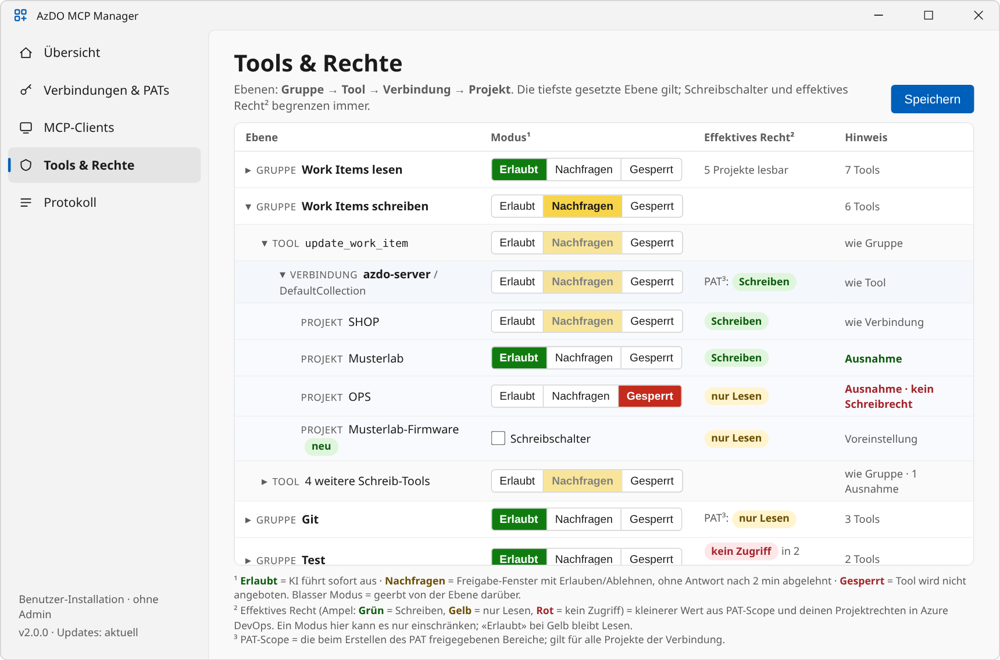

# Tools

Der MCP-Server `azdo-mcp.exe` bietet Ihrem KI-Assistenten 31 Tools an. Sie rufen die Tools nicht selbst auf: Sie stellen eine Frage in normaler Sprache, der Assistent wählt das passende Tool und füllt die Parameter. Dieses Kapitel zeigt, was jedes Tool kann, damit Sie wissen, welche Fragen möglich sind, und unter «Tools & Rechte» gezielt einzelne Tools erlauben, nachfragen lassen oder sperren können ([Berechtigungen und Freigaben](06-berechtigungen-und-freigaben.md)).

## Grundsätzliches

**Tool-Gruppen.** Die Tools sind in sieben Gruppen eingeteilt. Die Gruppen erscheinen unter «Tools & Rechte» mit genau diesen Namen. Jede Gruppe gehört zu einem Bereich, dessen effektives Recht (Lesen bzw. Schreiben) das Tool braucht:

| Tool-Gruppe | Bereich | Recht | Anzahl Tools |
|---|---|---|---|
| Work Items lesen | Work Items | Lesen | 8 |
| Work Items schreiben | Work Items | Schreiben | 6 |
| Git | Code | Lesen | 6 |
| Pipelines | Pipelines | Lesen | 3 |
| Test | Test | Lesen | 4 |
| Planung | Iterationen | Lesen | 2 |
| System | – | – | 2 |

Nur die Gruppe «Work Items schreiben» ändert etwas in Azure DevOps. Alle anderen Tools lesen nur. Schreib-Tools stehen erst zur Verfügung, wenn für das Projekt der Schreibschalter an ist.

**Parameter `project`.** Fast jedes Tool hat den optionalen Parameter `project`. Er nimmt den **Kurznamen** eines eingerichteten Projekts auf, z. B. `SHOP`, `OPS` oder `MUSTERLAB` – nicht den vollständigen Projektnamen in Azure DevOps. Fehlt die Angabe, gilt das Standardprojekt. Der Server nennt dem Assistenten beim Verbinden alle Kurznamen; Sie schreiben deshalb einfach «Zeig die offenen Bugs in SHOP». Ein unbekannter Kurzname ist ein Fehler, nicht eingerichtete Projekte sind nicht erreichbar ([Verbindungen und Projekte](04-verbindungen-und-projekte.md)).

**Work-Item-IDs** gelten für die ganze Collection. Ein Tool liest oder ändert nur Work Items des angegebenen Projekts. Fragen Sie in SHOP nach einem Work Item, das in OPS liegt, lehnt der Server ab, noch bevor eine Freigabe angefragt wird (Meldung im Kapitel [Meldungen und Fehlerbehebung](09-meldungen-und-fehlerbehebung.md)).

**Mengen.** Listen liefern höchstens so viele Einträge, wie `top` angibt (die Voreinstellung steht beim Tool). Wird eine Liste gekürzt, steht das im Ergebnis, und der Assistent kann die Abfrage eingrenzen. Zeiträume (`from`, `to`) werden als Datum im Format ISO 8601 angegeben, z. B. `2026-11-01`. Ohne Angabe gelten bei Builds, Releases und Testläufen die letzten 30 Tage.

**Fehlende Leserechte.** Fehlt in einem Projekt das Lesen eines Bereichs, lassen Tools, die mehrere Bereiche verbinden (z. B. `trace_links`), diesen Teil aus und vermerken das im Ergebnis («… kein Lesezugriff – ausgelassen»).

## Work Items lesen

| Tool | Zweck | Wichtige Parameter |
|---|---|---|
| `get_work_item` | Liest ein Work Item per ID, optional nur ausgewählte Felder und mit Relationen. | `id` (Pflicht), `fields` (Feld-Referenznamen, z. B. `System.Title`; ohne Angabe alle Felder), `includeRelations`, `project` |
| `query_by_id` | Führt eine in Azure DevOps gespeicherte Abfrage aus und liefert die Work Items. | `queryId` (Pflicht, GUID der Abfrage), `top`, `fields`, `project` |
| `execute_wiql` | Führt eine WIQL-Abfrage aus und liefert die gefundenen Work Items. | `wiql` (Pflicht, z. B. `SELECT [System.Id] FROM WorkItems WHERE ...`), `top`, `fields`, `project` |
| `query_work_items` | Sucht Work Items nach einfachen Filtern, ohne dass WIQL nötig ist. | `type` (z. B. `Bug`), `state` (z. B. `Active`), `assignedTo` (Name, E-Mail oder `@Me`), `areaPath`, `iterationPath` (jeweils inkl. Unterpfade), `titleContains`, `top` (Standard 50), `project` |
| `get_work_items_with_relations` | Liest mehrere Work Items per ID inklusive aller Relationen. | `ids` (Pflicht, Liste), `project` |
| `get_linked_work_items` | Liefert die mit einem Work Item verknüpften Work Items, optional nach Relationstyp gefiltert. | `id` (Pflicht), `relationType` (`parent`, `child`, `related`, `predecessor`, `successor`, `duplicate`, `duplicate-of`, `tests`, `tested-by` oder Referenzname), `project` |
| `get_work_item_revisions` | Liefert die Änderungshistorie (Revisionen) eines Work Items. | `id` (Pflicht), `top` (Standard 50), `project` |
| `trace_links` | Verfolgt Verknüpfungen in beide Richtungen: von Work Items, einem Pull Request, einem Commit oder einem Testlauf zu Pull Requests, Commits, Branches, Builds, Testfällen, Testergebnissen, Bugs und auf Wunsch zu über- und untergeordneten Work Items. Liefert Knoten, Kanten und eine Zusammenfassung je Start. | genau ein Start: `workItems` (IDs) oder `wiql`, `pullRequest`, `commit` (mit `repository`), `testRun`; dazu `include` (Arten, Standard: alle ausser `children` und `parent`), `depth` (1 oder 2), `refPattern` (regulärer Ausdruck, z. B. `REQ-\d+`), `project` |

`refPattern` verbindet zusätzlich Objekte, deren Titel, Commit-Nachricht, Branch- oder Testname denselben Treffer enthalten – nützlich, wenn Anforderungsnummern nur im Text stehen.

## Work Items schreiben

Diese Tools ändern Daten in Azure DevOps. Sie sind nur verfügbar, wenn der Schreibschalter des Projekts an ist und das effektive Recht «Work Items Schreiben» nicht «nein» ist. Voreinstellung für neue Projekte ist «Nachfragen»: Vor jeder Änderung erscheint das Freigabefenster ([Berechtigungen und Freigaben](06-berechtigungen-und-freigaben.md)).

| Tool | Zweck | Wichtige Parameter |
|---|---|---|
| `create_work_item` | Legt ein Work Item an (Bug, Task, User Story, Feature, Epic oder jeden anderen Typ des Projekts). | `type` und `title` (Pflicht), `description` (HTML erlaubt), `assignedTo`, `areaPath`, `iterationPath`, `tags` (mit `;` getrennt), `parentId`, `fields` (weitere Felder als `{ "Referenzname": Wert }`), `project` |
| `update_work_item` | Ändert Felder eines Work Items, z. B. Status, Zuweisung oder Priorität. | `id` (Pflicht), `title`, `state`, `assignedTo`, `fields` (z. B. `{ "System.State": "Resolved" }`), `project` |
| `add_work_item_comment` | Fügt einem Work Item einen Kommentar hinzu. | `id` und `text` (Pflicht, HTML oder Markdown), `project` |
| `update_work_item_comment` | Ändert einen bestehenden Kommentar eines Work Items. | `id`, `commentId` und `text` (Pflicht), `project` |
| `add_work_item_relation` | Verknüpft zwei Work Items (`parent`, `child`, `related`, `predecessor`, `successor`, `duplicate`, …). | `id`, `targetId` und `relationType` (Pflicht), `comment`, `project` |
| `add_work_item_attachment` | Hängt eine Datei an ein Work Item an, höchstens 60 MB. | `id` (Pflicht), `filePath` (lokaler Pfad) oder `contentBase64` mit `fileName`, `comment`, `project` |

Bei `update_work_item` liest der Server vor der Freigabe die aktuellen Werte und zeigt im Freigabefenster «alt → neu», z. B. «Status Active → Resolved».

## Git

Die Git-Tools lesen Repositories, Commits, Branches und Pull Requests als Daten für Auswertungen. Sie führen keine Git-Operationen aus (kein Klonen, kein Mergen, kein Push).

| Tool | Zweck | Wichtige Parameter |
|---|---|---|
| `get_repositories` | Listet die Git-Repositories des Projekts. | `project` |
| `get_commits` | Listet Commits eines Repositories, optional nach Branch, Autor und Zeitraum. | `repository` (Pflicht, Name oder ID), `branch`, `author`, `fromDate`, `toDate`, `top` (Standard 50), `project` |
| `get_branches` | Branches eines Repositories mit letztem Commit, ahead/behind gegenüber dem Default-Branch und aktivem Pull Request. | `repository` (Pflicht), `prefix` (z. B. `feature/`), `staleDays` (nur Branches ohne Commit seit so vielen Tagen), `withoutPullRequest`, `project` |
| `get_pull_requests` | Pull Requests als Daten für Auswertungen, auf Wunsch mit Reviewern, Kommentaren, Iterationen, Dateien und Work Items. | `status` (`active`, `completed`, `abandoned`, `all`), `repository`, `targetBranch`, `author`, `reviewer`, `from`/`to`, `include` (`reviewers`, `threads`, `iterations`, `files`, `workItems`), `includeSystem`, `top` (Standard 100, höchstens 1000), `project` |
| `get_pull_request` | Ein Pull Request mit Beschreibung, Reviewern und Stimmen, allen Kommentar-Threads, Pushes, geänderten Dateien und verknüpften Work Items. | `id` (Pflicht), `includeSystem` (auch Systemeinträge wie Stimmen, Pushes, Richtlinien), `project` |
| `analyze_pull_requests` | Kennzahlen zu Pull Requests, gruppiert (siehe [Auswertungen](07-tools.md#auswertungen)). | Filter wie `get_pull_requests`, dazu `groupBy`, `metrics`, `exclude`, `project` |

Bei `get_pull_requests` beziehen sich `from` und `to` bei abgeschlossenen und abgebrochenen Pull Requests auf das Abschlussdatum, sonst auf das Erstelldatum.

## Pipelines

Die Gruppe braucht das Recht «Pipelines Lesen» (PAT-Scope «Build (Read)», für Releases zusätzlich «Release (Read)»).

| Tool | Zweck | Wichtige Parameter |
|---|---|---|
| `get_pipelines` | Listet Build-Pipelines und Release-Definitionen (ID, Name, Art, Pfad). | `name` (enthält), `kind` (`build` oder `release`, Standard beide), `project` |
| `get_builds` | Builds, neueste zuerst, mit Nummer, Pipeline, Branch, Tags, Status und Ergebnis. | `pipelineId`, `branch`, `tags`, `result` (`succeeded`, `partiallySucceeded`, `failed`, `canceled`), `from`/`to` (Standard letzte 30 Tage), `top` (Standard 100, höchstens 1000), `project` |
| `get_releases` | Releases, neueste zuerst, mit Definition und Stages (Name, Status). | `definitionId`, `from`/`to` (Standard letzte 30 Tage), `top` (Standard 100, höchstens 1000), `project` |

Kennt der Server keine Release-Definitionen (ältere Azure DevOps Server ohne diese Schnittstelle), vermerkt das Ergebnis «Release-Definitionen: auf diesem Server nicht verfügbar».

## Test

| Tool | Zweck | Wichtige Parameter |
|---|---|---|
| `get_test_plans` | Listet die Testpläne des Projekts (ID, Name, Status, Root-Suite). | `project` |
| `get_test_runs` | Testläufe, neueste zuerst, mit Build (Nummer, Pipeline, Branch) und Release (Name, Stage). | `from`/`to` (Standard letzte 30 Tage), `planId`, `buildId`, `releaseId`, `releaseDefinitionId`, `pipelineId`, `branch`, `tags` (braucht «Pipelines Lesen»), `runName`, `state`, `top` (Standard 100, höchstens 1000), `project` |
| `get_test_results` | Testergebnisse eines Laufs, Builds, Releases oder Testplans (genau eines davon), beginnend mit der Anzahl je Ergebnis. | `runId`, `buildId`, `releaseId` oder `planId`; `from`/`to`, `outcome` (z. B. `Failed`), `latest` (`none` oder `testCase+configuration`), `top` (Standard 500, höchstens 5000), `project` |
| `analyze_test_results` | Kennzahlen zu Testergebnissen, gruppiert (siehe [Auswertungen](07-tools.md#auswertungen)). | Auswahl wie `get_test_runs` plus `runId`, dazu `latest`, `groupBy`, `metrics`, `project` |

Mit `latest=testCase+configuration` liefert `get_test_results` nur das neueste Ergebnis je Testfall und Konfiguration – das ist der aktuelle Stand eines Testplans.

## Planung

| Tool | Zweck | Wichtige Parameter |
|---|---|---|
| `get_iterations` | Listet die Iterationen (Sprints) eines Teams. | `team` (Standard: Standardteam des Projekts), `timeframe` (`current` liefert nur den aktuellen Sprint), `project` |
| `get_iteration_capacity` | Liefert die Kapazität der Teammitglieder in einer Iteration. | `iterationId` (Pflicht, GUID aus `get_iterations`), `team`, `project` |

## System

| Tool | Zweck | Wichtige Parameter |
|---|---|---|
| `list_projects` | Listet die eingerichteten Projekte: Kurzname, Verbindung, Server, Standard, Schreibschalter, effektive Rechte je Bereich (Lesen/Schreiben mit ja, nein, n/a oder ?), Status und PAT-Status. | keine |
| `ping` | Prüft, ob der Server einer Verbindung erreichbar ist und der PAT gilt. | `project` |

`list_projects` braucht keine Verbindung zu Azure DevOps und eignet sich als erste Testfrage: «Welche Azure-DevOps-Projekte kennst du?»

## Auswertungen

Für Kennzahlen und Übersichten gibt es zwei Auswertungs-Tools: `analyze_pull_requests` (Gruppe «Git») und `analyze_test_results` (Gruppe «Test»). Sie rechnen die Kennzahlen im Server aus, statt dass der Assistent hunderte Einzelabfragen macht. Ergänzt werden sie durch `trace_links` für Zusammenhänge zwischen Work Items, Code, Builds und Tests.

### Pull Requests auswerten

`analyze_pull_requests` nimmt dieselben Filter wie `get_pull_requests` und zusätzlich:

| Parameter | Werte |
|---|---|
| `groupBy` | `none` (Standard), `author`, `reviewer`, `repository`, `targetBranch`, `month`, `week`, `threadStatus`, `file` |
| `metrics` | `count`, `completed`, `abandoned`, `cycleTime`, `iterations`, `files`, `comments`, `commentsPerPr`, `commentsPerFile`, `threadStatus`, `reviewersPerPr`, `firstResponse`, `approvalRate`, `rejectionRate` (Standard: `count`, `completed`, `abandoned`, `cycleTime`) |
| `exclude` | `{ "titlePattern": "^\\[TEST\\]", "authors": ["Build Bot"] }` – blendet z. B. Test-PRs und Bots aus |

Personen werden über ihr Login gruppiert, nicht über den Anzeigenamen. Kommentare zählen nur Text-Kommentare, keine Systemeinträge.

### Testergebnisse auswerten

`analyze_test_results` wählt die Ergebnisse über `runId`, `buildId`, `releaseId`, `planId`, `releaseDefinitionId`, `pipelineId`, `branch`, `tags` und `from`/`to` (Standard letzte 30 Tage) und nimmt zusätzlich:

| Parameter | Werte |
|---|---|
| `latest` | `testCase+configuration` (Standard): je Gruppe zählt nur das neueste Ergebnis je Testfall und Konfiguration; `none`: alle Ergebnisse |
| `groupBy` | `none` (Standard), `build`, `release`, `stage`, `run`, `outcome`, `testCase`, `computerName`, `day`, `week` |
| `metrics` | `total`, `passed`, `failed`, `notExecuted`, `passRate`, `duration`, `failingSince`, `newFailures` (Standard: `total`, `passed`, `failed`, `notExecuted`, `passRate`) |

`failed` zählt die Ergebnisse «Failed» und «Aborted» zusammen.

### Beispielfragen

Die Fragen stellen Sie so, wie Sie sie einer Kollegin stellen würden. Die Spalte rechts zeigt, welches Tool der Assistent typischerweise aufruft.

| Frage an den Assistenten | Typischer Aufruf |
|---|---|
| «Welche Branches im Repository SHOP haben seit 30 Tagen keinen Commit und keinen Pull Request?» | `get_branches` mit `repository=SHOP`, `staleDays=30`, `withoutPullRequest=true` |
| «Zeig mir alle Review-Kommentare zu Pull Request 812 in SHOP.» | `get_pull_request` mit `id=812`, `project=SHOP` |
| «Wie lange dauern Pull Requests in SHOP pro Entwickler, und wie viele Kommentare bekommen sie? Ohne Test-PRs.» | `analyze_pull_requests` mit `groupBy=author`, `metrics=count,cycleTime,commentsPerPr`, `exclude={titlePattern:"^\[TEST\]"}` |
| «Wie schnell reagieren die Reviewer in OPS, und wie oft stimmen sie zu?» | `analyze_pull_requests` mit `groupBy=reviewer`, `metrics=firstResponse,approvalRate,rejectionRate` |
| «Wie viele Pull Requests hat «Max Muster» im letzten Quartal abgeschlossen?» | `analyze_pull_requests` mit `author=Max Muster`, `status=completed`, `from`/`to` |
| «Wie ist der aktuelle Stand von Testplan 120 in Musterlab?» | `get_test_results` mit `planId=120`, `latest=testCase+configuration` |
| «Wie haben sich die Testergebnisse pro Build der Release-Definition 7 auf `main` entwickelt, und welche Fehler sind neu?» | `analyze_test_results` mit `releaseDefinitionId=7`, `branch=main`, `groupBy=build`, `metrics=total,passed,failed,passRate,newFailures` |
| «Welche Tests schlagen in OPS seit wann fehl?» | `analyze_test_results` mit `groupBy=testCase`, `metrics=failed,failingSince` |
| «Welche Builds sind diese Woche in SHOP fehlgeschlagen?» | `get_builds` mit `result=failed`, `from` |
| «Was hängt an Story 4711 – Pull Requests, Tests, Bugs?» | `trace_links` mit `workItems=[4711]`; mit `refPattern=REQ-\d+` auch Verweise im Text |
| «Was ist im aktuellen Sprint von SHOP noch offen?» | `get_iterations` mit `timeframe=current`, danach `query_work_items` mit `iterationPath` |

Die Bewertung von Kommentarinhalten (z. B. «Welche Kommentare betreffen Sicherheit?») macht der Assistent selbst anhand der gelieferten Daten. Die Auswertungs-Tools liefern Personen kompakt als Name und Login, ohne Avatar- oder Identity-URLs.
