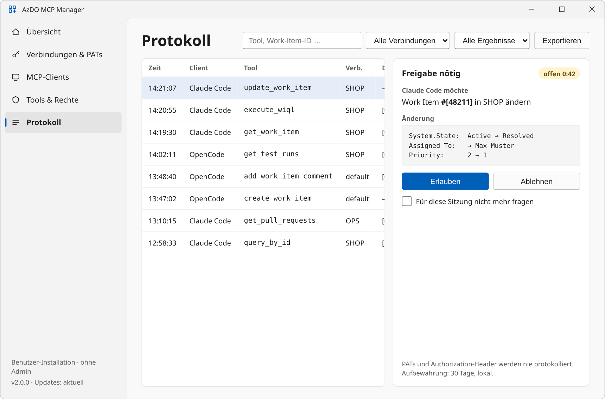

# Protokoll und Daten

## Protokoll

Jeder Tool-Aufruf eines KI-Assistenten wird protokolliert – erfolgreiche, fehlgeschlagene, abgelehnte und gesperrte. So sehen Sie jederzeit, was ein Assistent mit Ihrem Zugang zu Azure DevOps getan hat. Die Seite «Protokoll» im AzDO MCP Manager zeigt die Einträge.



### Spalten

| Spalte | Inhalt |
|---|---|
| Zeit | Uhrzeit des Aufrufs |
| Client | Name des Assistenten, z. B. «Claude Code», «Claude Desktop», «OpenCode», «VS Code / Copilot» |
| Tool | Name des Tools, z. B. `get_work_item` |
| Verb. | Kurzname des Projekts, z. B. `SHOP` (bei Tools ohne Projekt «–») |
| Dauer | Dauer des Aufrufs |
| Ergebnis | «OK», ein Fehler mit Kurztext (z. B. «401 PAT abgelaufen», «403 Scope fehlt»), «wartet auf Freigabe», «abgelehnt» oder «gesperrt» |

Oben filtern Sie nach Verbindung («Alle Verbindungen»), Ergebnis («Alle Ergebnisse», «OK», «Fehler», «wartet auf Freigabe», «abgelehnt», «gesperrt») und Text («Tool, Work-Item-ID …»). Rechts steht die offene Freigabe mit «Erlauben» und «Ablehnen»; gibt es keine, steht dort «Keine offene Freigabe.»

### Export

«Exportieren» speichert die gefilterten Einträge als CSV-Datei an einem Ort Ihrer Wahl (Vorschlag `azdo-mcp-protokoll-<JJJJMMTT>.csv`). Die Datei hat die Spalten `Zeit;Client;Tool;Verbindung;Dauer (s);Ergebnis`, ist UTF-8-kodiert und mit Semikolon getrennt, damit Excel sie direkt öffnet. Danach meldet der Manager z. B. «42 Einträge exportiert:» mit dem Pfad.

### Was protokolliert wird – und was nicht

Das Protokoll enthält nur **Metadaten**:

- Zeit, Client, Tool, Kurzname des Projekts, Dauer, Ergebnis
- ob der Aufruf schreibend war und gegebenenfalls die Work-Item-ID
- eine Kennung, die «wartet auf Freigabe» und das spätere Ergebnis derselben Anfrage verbindet

Das Protokoll enthält **nie**:

- PATs oder Authorization-Header
- Feldwerte von Work Items (Titel, Beschreibung, Status-Werte usw.)
- Kommentartexte
- Inhalte von Anhängen

Beispiel: Ruft der Assistent `add_work_item_comment` auf, steht im Protokoll die Work-Item-ID, nicht der Kommentartext. Der Manager zeigt dazu unten auf der Seite: «PATs und Authorization-Header werden nie protokolliert. Aufbewahrung: 30 Tage, lokal.»

### Aufbewahrung

Das Protokoll liegt als eine Datei pro Tag unter `%LOCALAPPDATA%\AzdoMcpData\logs\` (`audit-JJJJMMTT.jsonl`, eine Zeile pro Aufruf). Dateien, die älter als 30 Tage sind, löschen Server und Manager beim Start automatisch. Laufen mehrere Server gleichzeitig (z. B. Claude Code und VS Code), schreiben alle in dieselbe Tagesdatei, ohne dass sich Zeilen vermischen. Das Protokoll verlässt den Rechner nicht.

## Datenordner

Alle Benutzerdaten liegen im Benutzerprofil unter:

```text
%LOCALAPPDATA%\AzdoMcpData\
```

Der Ordner ist bewusst vom Programmordner `%LOCALAPPDATA%\AzdoMcp\` getrennt. Updates, Neuinstallation und Deinstallation lassen ihn unverändert ([Update und Deinstallation](10-update-und-deinstallation.md)). Die Portable-Variante verwendet denselben Datenordner.

| Datei oder Ordner | Inhalt |
|---|---|
| `connections.json` | Verbindungen (Name, Collection-URL, Erinnerung, Ablaufdatum des PAT) und Projekte (Kurzname, Standardprojekt, Schreibschalter, geprüfte Rechte). Enthält **keinen** PAT. |
| `permissions.json` | Modi unter «Tools & Rechte» (Erlaubt, Nachfragen, Gesperrt) je Gruppe, Tool, Verbindung und Projekt |
| `secrets\<id>.bin` | Der PAT einer Verbindung, verschlüsselt mit Windows DPAPI; `<id>` ist die interne Kennung der Verbindung aus `connections.json` |
| `logs\audit-JJJJMMTT.jsonl` | Protokoll, eine Datei pro Tag, 30 Tage |
| `reminders.json` | Wann die Erinnerung «PAT erneuern» zuletzt angezeigt wurde |
| `update.json` | Nur wenn angelegt: Update-Quelle ([Update und Deinstallation](10-update-und-deinstallation.md)) |
| `connections.v1.bak.json`, `connections.v2.bak.json` | Nur nach einer Migration: Sicherung der alten `connections.json` aus Version 2.0 bzw. 2.1 |

### Wie der PAT geschützt ist

- Der PAT wird ausschliesslich mit Windows DPAPI für den angemeldeten Windows-Benutzer verschlüsselt gespeichert (`secrets\<id>.bin`). Nur dieser Benutzer auf diesem Rechner kann ihn entschlüsseln; eine kopierte Datei ist auf einem anderen Rechner oder für einen anderen Benutzer wertlos.
- Der PAT steht nie im Klartext auf der Festplatte, nie in `connections.json`, nie im Protokoll, nie in den Ergebnissen, die der Assistent erhält, und nie in den Konfigurationsdateien der MCP-Clients. Die Clients starten nur `azdo-mcp.exe --stdio`; der Server liest den PAT selbst.
- Fehlertexte von Azure DevOps werden vor der Anzeige bereinigt: Taucht darin der PAT oder ein Authorization-Wert auf, wird er durch `***` ersetzt.
- Ein PAT, der sich nicht mehr entschlüsseln lässt (z. B. nach Zurücksetzen des Windows-Kennworts durch die IT oder nach Kopieren des Profils auf einen anderen Rechner), wird als «PAT nicht lesbar – bitte ersetzen» angezeigt. Geben Sie ihn unter «Verbindungen & PATs» neu ein.

### Alte Klartext-Konfiguration

Findet der Manager eine `config.json` der Vorgängerversion 1 mit PATs im Klartext, zeigt die Übersicht z. B. «1 PAT im Klartext gefunden». Importieren fasst die Einträge pro Collection zu Verbindungen zusammen, speichert die PATs verschlüsselt und löscht die alte Datei.

### Was nicht gespeichert wird

- keine Inhalte aus Azure DevOps (Work Items, Code, Testergebnisse) – der Server fragt bei jedem Aufruf neu ab und gibt das Ergebnis nur an den Assistenten weiter
- keine Telemetrie; der Manager und der Server sprechen nur mit Ihrem Azure DevOps und, falls konfiguriert, mit der Update-Quelle

### Anderer Datenordner (`AZDOMCP_DATA`)

Ist die Umgebungsvariable `AZDOMCP_DATA` gesetzt, verwenden Manager und Server diesen Ordner statt `%LOCALAPPDATA%\AzdoMcpData\`. Das ist für Tests und Vorführungen gedacht, damit Ihre echten Verbindungen unberührt bleiben. Für den normalen Betrieb setzen Sie die Variable nicht. Manager und Server müssen denselben Ordner sehen, sonst findet der Server die eingerichteten Projekte nicht.
