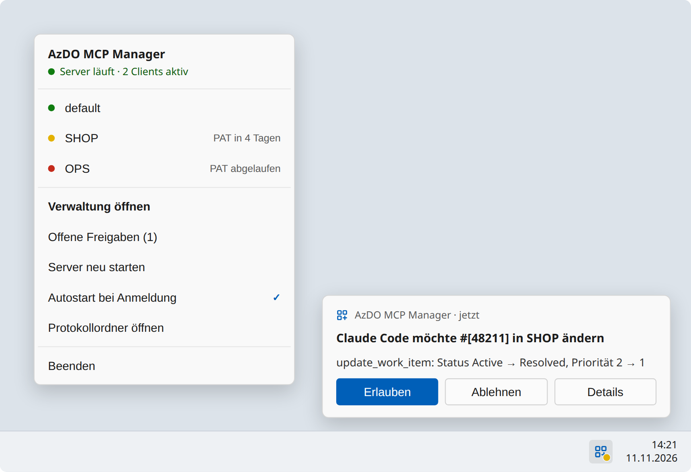

# Meldungen und Fehlerbehebung

Meldungen kommen aus zwei Quellen:

- **AzDO MCP Manager:** Fenster mit «OK»-Knopf, Texte auf den Seiten, Hinweise am Tray-Symbol.
- **MCP-Server `azdo-mcp.exe`:** Fehlertexte, die der KI-Assistent als Ergebnis eines Tool-Aufrufs erhält. Der Assistent gibt sie meist wörtlich oder sinngemäss wieder. Dieselben Fälle stehen mit Kurztext in der Spalte «Ergebnis» der Seite «Protokoll» ([Protokoll und Daten](08-protokoll-und-daten.md)).

Werte wie Kurznamen, Verbindungsnamen, IDs oder Anzahlen sind in den Beispielen durch Beispielwerte ersetzt (`SHOP`, `OPS`, `MUSTERLAB`, Verbindung `azdo-example`). Ein «…» am Ende steht für den Text, den Azure DevOps oder Windows mitliefert.

Allgemeines Vorgehen bei Problemen:

1. «Verbindungen & PATs» öffnen, Verbindung wählen, «Verbindung testen».
2. Seite «Protokoll» öffnen und das Ergebnis des betroffenen Aufrufs lesen.
3. Nach Änderungen an Verbindungen oder Rechten liest ein laufender Server diese selbst neu ein. Im Zweifel im Tray-Menü «Server neu starten» wählen.

## Verbindung und PAT

### Ergebnis von «Verbindung testen»

Der Verbindungstest prüft Erreichbarkeit, Anmeldung, Projekte und Ablaufdatum des PAT und zeigt je Punkt eine Zeile.

| Zeile | Ursache | Massnahme |
|---|---|---|
| «Server nicht erreichbar» | Collection-URL falsch, Server aus, kein Netz oder VPN, Proxy blockiert. | URL im Browser öffnen. Muss die Form `https://azdo.example.local/DefaultCollection` haben (bei Azure DevOps Services `https://dev.azure.com/<Organisation>`). VPN prüfen. |
| «Server antwortet mit Fehler» | Der Server ist erreichbar, liefert aber einen HTTP-Fehler (z. B. falscher Collection-Name, Wartung). | Collection-URL prüfen; die Details stehen in der Zeile. |
| «Anmeldung fehlgeschlagen» – «PAT abgelaufen oder ungültig» | PAT abgelaufen, widerrufen, falsch kopiert oder für eine andere Organisation erstellt. | Neuen PAT in Azure DevOps erstellen («PAT erstellen ↗») und unter «Verbindungen & PATs» eintragen. |
| «Projekte nicht lesbar» | Dem PAT fehlt ein Scope zum Lesen von Projekten. | PAT mit den Scopes aus [Voraussetzungen](02-voraussetzungen.md) neu erstellen. |
| «Mit diesem PAT ist kein Projekt sichtbar» | Ihr Konto ist in keinem Projekt dieser Collection Mitglied, oder der PAT ist auf eine andere Organisation beschränkt. | Projektmitgliedschaft in Azure DevOps prüfen lassen. |
| «PAT ist abgelaufen» | Ablaufdatum überschritten. | Neuen PAT eintragen. |
| «PAT läuft in 5 Tagen ab» | Ablaufdatum innerhalb der eingestellten Erinnerungsfrist. | Rechtzeitig einen neuen PAT erstellen und eintragen. |

### Erinnerung «PAT erneuern»

> «PAT für azdo-example läuft in 5 Tagen ab» · «PAT für azdo-example läuft heute ab» · «PAT für azdo-example ist abgelaufen»

**Ursache:** Hinweis am Tray-Symbol, höchstens einmal pro Tag und Verbindung, sobald die Erinnerungsfrist der Verbindung erreicht ist (einstellbar: «3 Tage vorher» bis «30 Tage vorher»).

**Massnahme:** Auf den Hinweis klicken, neuen PAT erstellen und unter «Verbindungen & PATs» eintragen. Der neue PAT gilt sofort für alle Projekte der Verbindung.

### PAT nicht lesbar

> «PAT nicht lesbar – bitte ersetzen»

Beim Server bzw. Befehl `discover`: «PAT für azdo-example nicht lesbar – bitte ersetzen».

**Ursache:** Die verschlüsselte PAT-Datei lässt sich mit Windows DPAPI nicht entschlüsseln, z. B. nach einem Zurücksetzen des Windows-Kennworts durch die IT, nach Übertragen des Profils auf einen anderen Rechner oder weil die Datei beschädigt ist.

**Massnahme:** Unter «Verbindungen & PATs» den PAT neu eingeben und speichern. Einstellungen der Projekte bleiben erhalten.

### 401 – PAT abgelaufen oder ungültig

> «401 PAT abgelaufen oder ungültig.»

Im Protokoll: «401 PAT abgelaufen».

**Ursache:** Azure DevOps lehnt den PAT ab (abgelaufen, widerrufen oder falsch).

**Massnahme:** Neuen PAT eintragen. Die Übersicht zeigt die Verbindung danach wieder als gültig.

### 403 – Scope fehlt

> «403 Scope fehlt: …» oder «403 Scope fehlt – Code: kein Zugriff in SHOP»

Im Protokoll: «403 Scope fehlt».

**Ursache:** Dem PAT fehlt der Scope für diesen Bereich, oder Ihr Konto hat im Projekt kein entsprechendes Recht. Die zweite Form meldet der Server, bevor er Azure DevOps fragt, weil das geprüfte Recht für den Bereich «nein» ist.

**Massnahme:** PAT mit dem fehlenden Scope neu erstellen (siehe [Voraussetzungen](02-voraussetzungen.md)) und eintragen, danach «Neu einlesen». Fehlt das Projektrecht, die Projektadministration in Azure DevOps fragen.

### Server nicht erreichbar oder Zeitüberschreitung

> «Server nicht erreichbar: …»

> «Zeitüberschreitung nach 120 s – Server antwortet nicht.»

Im Protokoll: «nicht erreichbar».

**Ursache:** Netzwerk, VPN oder Proxy; Server überlastet oder in Wartung. Bei der Zeitüberschreitung hat der Server innerhalb der Wartezeit nicht geantwortet, etwa bei einer sehr grossen Abfrage.

**Massnahme:** Verbindung testen, VPN prüfen. Bei grossen Abfragen den Assistenten bitten, den Zeitraum oder die Menge einzugrenzen.

### Auf diesem Server nicht verfügbar

> «Auf diesem Server nicht verfügbar.» oder «Auf diesem Server nicht verfügbar (API-Version zu neu).»

**Ursache:** Die Funktion gibt es auf Ihrer Version von Azure DevOps Server nicht (z. B. ältere Server ohne Release-Definitionen oder mit älterer REST-API).

**Massnahme:** Keine; das Tool steht auf diesem Server nicht zur Verfügung. Bei Bedarf die IT nach einem Update des Azure DevOps Servers fragen.

### Weitere Antworten von Azure DevOps

| Meldung | Ursache | Massnahme |
|---|---|---|
| «404 Nicht gefunden: …» | Objekt (Work Item, Repository, Abfrage, Testlauf) existiert nicht oder ist für Ihr Konto unsichtbar. | ID bzw. Namen prüfen. |
| «400 Ungültige Anfrage: …» | Azure DevOps lehnt die Anfrage ab, z. B. ungültiges WIQL, unbekannter Status oder Pflichtfeld fehlt. | Text nach dem Doppelpunkt lesen; der Assistent korrigiert die Anfrage meist selbst. |
| «Antwort des Servers ist kein JSON.» | Zwischen Ihnen und Azure DevOps liefert ein Proxy oder eine Anmeldeseite HTML statt der erwarteten Antwort. | Collection-URL und Proxy prüfen; IT fragen. |

### Eingaben beim Anlegen einer Verbindung

| Meldung | Ursache und Massnahme |
|---|---|
| «Collection-URL muss mit https:// beginnen.» | Unverschlüsselte Adressen sind nicht erlaubt. URL mit `https://` eingeben. |
| «Personal Access Token fehlt.» | Feld «Personal Access Token» ist leer. PAT einfügen. |
| «Name der Verbindung fehlt.» | Feld «Name der Verbindung» ist leer. Namen eingeben. |
| «Der Name „azdo-example“ wird bereits verwendet.» | Es gibt schon eine Verbindung mit diesem Namen. Anderen Namen wählen. |
| «Der Name darf nur Buchstaben, Ziffern, „-“, „_“ und „.“ enthalten (max. 40 Zeichen).» | Ungültige Zeichen im Namen. Namen ändern. |
| «Erinnerung muss zwischen 0 und 365 Tagen liegen.» | Ungültige Erinnerungsfrist. Wert aus der Liste wählen. |

## Projekte und Kurznamen

### Kein Projekt eingerichtet

> «Kein Projekt eingerichtet – im AzDO MCP Manager unter „Verbindungen & PATs“ eine Verbindung anlegen und Projekte erkennen.»

**Ursache:** Der Server läuft, aber im Datenordner ist kein Projekt eingerichtet. Auch der Fall, wenn Manager und Server verschiedene Datenordner verwenden (`AZDOMCP_DATA`, siehe [Protokoll und Daten](08-protokoll-und-daten.md)).

**Massnahme:** Im Manager «+ Neue Verbindung» bzw. «Projekte erkennen» ausführen ([Verbindungen und Projekte](04-verbindungen-und-projekte.md)).

### Kein Standardprojekt

> «Kein Standardprojekt festgelegt. „project“ angeben: SHOP, OPS.»

**Ursache:** Die Frage nennt kein Projekt, und kein Projekt ist als «Standardprojekt» markiert.

**Massnahme:** In der Frage das Projekt nennen («… in SHOP») oder unter «Verbindungen & PATs» ein Projekt als «Standardprojekt» markieren.

### Unbekannter Kurzname

> «Unbekannter Kurzname „SHP“. Eingerichtet: SHOP, OPS, MUSTERLAB.»

**Ursache:** Der Assistent hat einen Kurznamen verwendet, den es nicht gibt – oft nach einer Umbenennung, wenn der Client noch die alte Tool-Liste kennt.

**Massnahme:** Den richtigen Kurznamen verwenden. Nach einer Umbenennung den Client neu starten oder eine neue Unterhaltung beginnen.

### Work Item gehört zu einem anderen Projekt

> «Work Item 5000 gehört nicht zu SHOP – es liegt in OPS»

**Ursache:** Work-Item-IDs gelten für die ganze Collection. Ein Tool darf nur Work Items des angegebenen Projekts lesen oder ändern. Die Anfrage wird vor jeder Freigabe abgelehnt (Ergebnis «abgelehnt»). Liegt das Work Item in einem nicht eingerichteten Projekt, fehlt der Zusatz «– es liegt in …».

**Massnahme:** Die Frage mit dem richtigen Projekt stellen («… in OPS»). Ist das Projekt nicht eingerichtet, es zuerst mit «Projekte erkennen» einrichten.

### Projekt nicht mehr sichtbar

> «kein Zugriff – SHOP ist in Azure DevOps nicht mehr sichtbar»

**Ursache:** «Neu einlesen» hat das Projekt mit dem aktuellen PAT nicht mehr gefunden: PAT oder Projektrechte geändert, oder das Projekt wurde gelöscht. Der Manager zeigt dazu «PAT oder Projektrechte geändert, oder Projekt gelöscht. Tools liefern dort «kein Zugriff», bis du es entfernst.» Die Einstellungen bleiben erhalten.

**Massnahme:** Rechte in Azure DevOps prüfen lassen und erneut «Neu einlesen», oder das Projekt unter «Neu einlesen» entfernen.

### Kurzname ungültig oder vergeben

| Meldung | Ursache und Massnahme |
|---|---|
| «Kurzname: 2–10 Zeichen, Buchstaben, Ziffern und -, beginnt mit Buchstabe» | Kurzname entspricht nicht den Regeln. Kurznamen anpassen. |
| «„PR“ ist reserviert» | `PR`, `BUG`, `ID`, `TEST`, `TASK` und `ALL` sind gesperrt, weil sie in Prompts mehrdeutig wären. Anderen Kurznamen wählen. |
| «Kurzname „SHOP“ wird bereits verwendet» | Kurznamen sind über alle Verbindungen eindeutig. Anderen Kurznamen wählen. |
| «Prompts mit dem alten Kurznamen funktionieren danach nicht mehr.» | Rückfrage vor dem Umbenennen. Bestätigen, wenn gewollt. |

### Hinweise bei der Erkennung

> «Security-API nicht verfügbar – Projektrechte per Lese-Test ermittelt (Schreiben: n/a).»

**Ursache:** Ältere Server bieten die Schnittstelle für Berechtigungen nicht an. Die Erkennung prüft das Lesen dann durch einen Lesezugriff; das Schreiben bleibt «n/a» und sperrt nicht.

**Massnahme:** Keine. Azure DevOps entscheidet beim Schreiben selbst.

> «Keine neuen Projekte ausgewählt – es werden nur die Rechte der bestehenden Projekte aktualisiert.»

**Ursache:** Im Assistenten «Projekte erkennen» ist kein neues Projekt angehakt. **Massnahme:** Gewünschte Projekte anhaken oder so übernehmen.

## Freigaben und Rechte

### Vom Benutzer abgelehnt

> «Vom Benutzer abgelehnt.»

**Ursache:** Sie haben im Freigabefenster «Ablehnen» gewählt. **Massnahme:** Keine. Soll das Tool ohne Rückfrage laufen, es unter «Tools & Rechte» auf «Erlaubt» stellen ([Berechtigungen und Freigaben](06-berechtigungen-und-freigaben.md)).

### Keine Antwort

> «Keine Antwort – abgelehnt (nach 2 min).»

**Ursache:** Das Freigabefenster wurde 2 Minuten lang nicht beantwortet. **Massnahme:** Den Assistenten die Aktion wiederholen lassen und rechtzeitig «Erlauben» wählen. Offene Freigaben zeigt auch die Seite «Protokoll».

### Manager nicht gestartet

> «AzDO MCP Manager nicht gestartet – Freigabe nicht möglich. Den Manager starten oder das Tool unter „Tools & Rechte“ auf „Erlaubt“ stellen.»

Im Protokoll: «abgelehnt – Manager nicht gestartet».

**Ursache:** Das Tool steht auf «Nachfragen», aber der Manager läuft nicht, also kann niemand die Freigabe erteilen. Wird der Manager beendet, während eine Freigabe offen ist, wird sie ebenfalls abgelehnt.

**Massnahme:** AzDO MCP Manager starten (Startmenü) und «Autostart bei Anmeldung» einschalten.

### Server pausiert

> «Vom Benutzer pausiert – im AzDO MCP Manager fortsetzen.»

**Ursache:** Der MCP-Server wurde im Manager gestoppt («Stoppen: jeder Tool-Aufruf wird abgelehnt, bis „Fortsetzen“»). Die Übersicht zeigt «MCP-Server pausiert», im Protokoll steht «gesperrt».

**Massnahme:** Im Manager «Fortsetzen» wählen.

### Für ein Projekt gesperrt

| Meldung | Ursache | Massnahme |
|---|---|---|
| «Für SHOP gesperrt (Schreibschalter aus).» | Schreib-Tool, aber der Schreibschalter des Projekts ist aus. | Unter «Verbindungen & PATs» den «Schreibschalter» des Projekts einschalten, wenn der Assistent schreiben soll. |
| «Für SHOP gesperrt (nur Lesen).» | Schreib-Tool, aber das effektive Recht «Work Items Schreiben» ist «nein» (PAT ohne Schreibrecht oder kein Projektrecht zum Bearbeiten). | PAT mit «Work Items (Read & write)» erstellen bzw. Projektrecht anfragen, dann «Neu einlesen». |
| «Für SHOP gesperrt.» | Das Tool oder die Gruppe ist für dieses Projekt auf «Gesperrt» gestellt. | Unter «Tools & Rechte» den Modus ändern. |
| «Für azdo-example gesperrt.» | Das Tool oder die Gruppe ist für die ganze Verbindung auf «Gesperrt» gestellt. | Unter «Tools & Rechte» den Modus ändern. |

Ist ein Tool in einzelnen Projekten gesperrt, steht in seiner Beschreibung für den Assistenten zusätzlich «Nicht verfügbar für: SHOP.» Ist es überall gesperrt, bietet der Server es gar nicht an.

### Rechte nicht lesbar

> «Rechte nicht lesbar – AzDO MCP Manager öffnen. …» bzw. im Manager «permissions.json ist ungültig: …»

**Ursache:** `permissions.json` im Datenordner ist beschädigt, meist nach einer Bearbeitung von Hand. Der Server sperrt dann vorsichtshalber.

**Massnahme:** Manager öffnen, «Tools & Rechte» prüfen und speichern. Hilft das nicht: `permissions.json` umbenennen; danach gelten wieder die Voreinstellungen.

### Speichern fehlgeschlagen

> «Speichern fehlgeschlagen» (Fenstertitel) mit Grund

**Ursache:** Die Datei im Datenordner ist gesperrt oder nicht beschreibbar (z. B. Virenscanner, volle Festplatte). **Massnahme:** Kurz warten und erneut speichern.

## MCP-Clients

### Eingetragen

> «Eingetragen in» mit Pfad der Datei, «Sicherung: …» und «Client neu starten, damit er den Server lädt.»

**Ursache:** Der Eintrag wurde gespeichert, vorher wurde eine Sicherung der Datei angelegt (Endung `.azdo-mcp-backup-<Datum>`). **Massnahme:** Den Client beenden und neu starten, dann die Testfrage stellen: «Welche Azure-DevOps-Projekte kennst du?»

### Nicht eingetragen

> «Nicht eingetragen» (Fenstertitel) mit «Die Datei wurde nicht verändert.» und einem der Gründe:

| Grund | Bedeutung |
|---|---|
| «Die Datei enthält kein JSON-Objekt.» | Die Konfigurationsdatei des Clients ist leer oder kein gültiges JSON. |
| «Unerwartetes Dateiende.» | Die Datei bricht mitten im JSON ab. |
| «„:“ erwartet.» | Doppelpunkt nach einem Namen fehlt. |
| «Klammer nicht geschlossen.» | Eine `{` oder `[` ist nicht geschlossen. |
| «Name in Anführungszeichen erwartet.» | Ein Name steht nicht in Anführungszeichen. |
| «Zeichenkette nicht geschlossen.» | Ein Anführungszeichen fehlt. |

**Ursache:** Die Konfigurationsdatei des Clients ist fehlerhaft; die Karte zeigt «Datei fehlerhaft». Der Manager ändert eine fehlerhafte Datei absichtlich nicht.

**Massnahme:** Datei im Editor korrigieren oder «Prompt kopieren» verwenden und den Assistenten die Einrichtung machen lassen ([MCP-Clients](05-mcp-clients.md)). Ohne Grund-Text (nur Windows-Meldung): Datei ist schreibgeschützt oder vom Client geöffnet – Client beenden und erneut versuchen.

### OpenCode: Eintrag unter «servers»

> «„servers“ unter „mcp“ ist kein gültiger Eintrag – Prompt nutzen oder Datei korrigieren»

**Ursache:** In `opencode.json` steht unter `mcp` ein Zwischenschlüssel `servers`, den OpenCode nicht kennt. Die Karte zeigt «prüfen».

**Massnahme:** «Prompt kopieren», in OpenCode einfügen; der Prompt verschiebt die Einträge eine Ebene nach oben.

### Claude Code nicht gefunden

> «Claude-Code-CLI („claude“) nicht gefunden. Befehl kopieren und in einem Terminal ausführen.»

oder

> «claude konnte nicht gestartet werden.»

**Ursache:** Der Befehl `claude` liegt nicht im Suchpfad (`PATH`) oder liess sich nicht starten.

**Massnahme:** «Befehl kopieren» und den Befehl in einem Terminal ausführen, in dem `claude` funktioniert.

## Updates

| Meldung | Ursache | Massnahme |
|---|---|---|
| «Update verfügbar» (Fenstertitel) mit «Version 2.6.0 installieren?» | Sie haben im Footer auf «Update verfügbar» geklickt. | «Ja» installiert; laufende MCP-Server werden beendet, der Manager startet neu. |
| «Update fehlgeschlagen» mit «2 MCP-Server laufen noch – bitte die Clients schliessen und erneut versuchen.» | Server liessen sich vor dem Austausch der Dateien nicht beenden. | Alle MCP-Clients schliessen und erneut auf «Update verfügbar» klicken. |
| «Update fehlgeschlagen» mit anderem Grund, Footer «Updates: Fehler» | Update-Quelle nicht erreichbar oder Download abgebrochen. | Quelle in `update.json` und Netz prüfen ([Update und Deinstallation](10-update-und-deinstallation.md)). |

## Server und Konfiguration

### Konfiguration ungültig

> «Konfiguration ungültig – AzDO MCP Manager öffnen. connections.json ist ungültig: …»

Auch: «connections.json ist leer.»; im Manager Fenster «Konfiguration».

**Ursache:** `connections.json` im Datenordner ist beschädigt oder leer, meist nach einer Bearbeitung von Hand oder einem abgebrochenen Kopiervorgang.

**Massnahme:** Datei aus einer Sicherung zurückholen (z. B. `connections.v2.bak.json` nach einer Migration, siehe [Update und Deinstallation](10-update-und-deinstallation.md)). Sonst `connections.json` umbenennen und die Verbindungen neu anlegen; die PAT-Dateien unter `secrets\` sind ohne passende `connections.json` nicht verwendbar.

### Meldungen des Servers auf stderr

Diese Texte schreibt `azdo-mcp.exe` in die Fehlerausgabe. Clients zeigen sie in ihrem MCP-Protokoll (z. B. Claude Code mit `claude mcp list` bzw. im Log, VS Code im Ausgabefenster «MCP»).

| Meldung | Ursache und Massnahme |
|---|---|
| «Hinweis: kein Projekt eingerichtet – AzDO MCP Manager öffnen.» | Noch kein Projekt eingerichtet. Verbindung im Manager anlegen. |
| «Warnung: …» | Datenordner oder Konfiguration beim Start nicht lesbar. Der Fehler wird beim ersten Tool-Aufruf erneut gemeldet. Siehe «Konfiguration ungültig». |
| «PAT-Speicherung benötigt Windows (DPAPI).» | Der Server läuft nicht unter Windows (z. B. in WSL oder einem Container). Die Windows-Version `azdo-mcp.exe` unter Windows verwenden. Exit-Code 3. |
| «Protokoll nicht schreibbar: …» | Der Ordner `logs\` ist gesperrt oder voll. Der Aufruf selbst läuft trotzdem. Speicherplatz und Rechte im Datenordner prüfen. |
| «AzDO MCP Manager installiert ein Update – Server wird beendet.» | Normal während eines Updates. Der Client startet den Server beim nächsten Aufruf neu. |
| Aufruftext «MCP-Server für Azure DevOps» mit «Aufruf:  azdo-mcp.exe --stdio» | `azdo-mcp.exe` wurde ohne `--stdio` gestartet, z. B. per Doppelklick. Der Server ist kein Programm zum direkten Starten; ihn startet der MCP-Client. Exit-Code 2. |

### Fehler in Parametern

Diese Meldungen gehen an den Assistenten, der die Anfrage meist selbst korrigiert. Im Protokoll steht «ungültige Parameter».

| Meldung | Bedeutung |
|---|---|
| «Parameter „id“ fehlt.» | Pflichtparameter fehlt. |
| «Unbekannter Wert „author2“ für groupBy. Erlaubt: …» | Wert nicht in der Liste der erlaubten Werte ([Tools](07-tools.md)). |
| «„refPattern“ ist kein gültiger regulärer Ausdruck.» | Suchmuster fehlerhaft. |
| «„refPattern“ ist zu lang (höchstens 200 Zeichen).» | Suchmuster zu lang. |
| «Nichts zu ändern: „fields“, „title“, „state“ oder „assignedTo“ angeben.» | `update_work_item` ohne Änderung aufgerufen. |
| «Ungültiger Feldname „System Title“.» | Feld-Referenzname mit ungültigen Zeichen. |
| «Datei nicht gefunden: …» | `add_work_item_attachment`: Pfad existiert nicht. |
| «„contentBase64“ ist kein gültiges Base64.» | Dateiinhalt falsch kodiert. |
| «Pull Request 812 gibt es in SHOP nicht.» | Pull Request gehört zu einem anderen Projekt oder existiert nicht. |
| «Der Filter „tags“ braucht Pipelines Lesen – in diesem Projekt nicht erlaubt.» | `tags` bei Testläufen braucht das Recht «Pipelines Lesen». |
| «Unbekanntes Tool „…“.» | Der Client hat eine veraltete Tool-Liste. Client neu starten. |

Anhänge über 60 MB lehnt der Server mit Angabe der Dateigrösse ab; 60 MB ist die Grenze von Azure DevOps.

### Hinweise in Ergebnissen

Manche Ergebnisse enthalten einen Hinweis statt eines Fehlers, z. B. «Mehr als 1000 Testläufe – nur die neuesten 1000 ausgewertet.» oder «20 weitere Work Items ausgelassen (Limit 50). Abfrage eingrenzen oder top erhöhen.» Das Ergebnis ist dann unvollständig; der Assistent kann die Abfrage eingrenzen.

### Interne Fehler

> «Interner Fehler (…): …» bzw. im Manager «Unerwarteter Fehler»

**Ursache:** Ein nicht vorhergesehener Fehler. **Massnahme:** Aktion wiederholen; tritt er erneut auf, Meldung, Zeitpunkt und Eintrag im Protokoll an den Support weitergeben (keinen PAT mitschicken).
